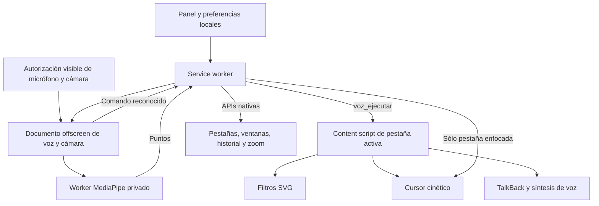

<p align="center">
  
</p>

# 🇵🇪 AdaptaPE — Sistema de accesibilidad por voz y movimiento

> **Versión del código Base:** 13.0 · Manifest V3.
> **Requisito mínimo del manifest:** Chromium 119 o posterior.
> **Navegadores objetivo:** Google Chrome y derivados Chromium, como Edge y Brave; la voz requiere una API de reconocimiento disponible.
> **Sitio oficial:** [adaptape.thealejo-dev.cc](https://adaptape.thealejo-dev.cc).
> **Detección desde la web:** `content_script.js` sólo marca `data-adapta-extension="true"` en `https://adaptape.cc`, `https://www.adaptape.cc` y `https://adaptape.thealejo-dev.cc`. En `localhost`, `http` u otros dominios la marca no aparece y la web local se comporta como si la extensión no estuviera instalada. No hay interruptor de desarrollo: para probar la web en local, ejecuta en la consola de la página `document.documentElement.setAttribute('data-adapta-extension','true')` (simula la marca; la extensión no la gestiona ahí) o, en una copia desempaquetada de pruebas, añade temporalmente el nombre de host a la lista de `content_script.js` (no lo subas).
> **Código fuente:** [TheAlejo160/Adapta-PE](https://github.com/TheAlejo160/Adapta-PE).

## Contenido

- [Qué es y qué versión elegir](#qué-es-y-qué-versión-elegir)
- [A quién está dirigida](#a-quién-está-dirigida)
- [Cómo se utiliza en el día a día](#cómo-se-utiliza-en-el-día-a-día)
- [Descarga e instalación](#descarga-e-instalación)
- [Primer uso](#primer-uso)
- [Usos y ejemplos](#usos-y-ejemplos)
- [Nueva pestaña de AdaptaPE](#nueva-pestaña-de-adaptape)
- [Comandos de voz](#comandos-de-voz)
- [Idioma de la extensión y de voz](#idioma-de-la-extensión-y-de-voz)
- [Cursor cinético y TalkBack](#cursor-cinético-y-talkback-sólo-base)
- [Filtros de color](#filtros-de-color)
- [Mascotas](#mascotas)
- [Arquitectura y código](#arquitectura-y-código)
- [Backend Python opcional](#backend-python-opcional-estado-real)
- [Privacidad y alcance](#privacidad-y-alcance)
- [Actualizaciones y solución de problemas](#actualizaciones-y-solución-de-problemas)
- [Desarrollo y comprobaciones](#desarrollo-y-comprobaciones)
- [Trabajo futuro](#trabajo-futuro)
- [Autoría, licencia y uso de IA](#autoría-licencia-y-uso-de-ia)

## Mascotas

Base 13.0 y Lite 3.0 permiten elegir **Tinku** (gallito de las rocas), **Cuchu** (cuy) o **Yati** (llama) en «Tu mascota». «Sin mascota» desactiva este acompañamiento opcional.

La mascota aparece abajo a la derecha en las webs permitidas, sigue el cursor físico y, en Base, el cinético. Arrastra su nombre o enfócalo con Tab y usa las flechas para moverla. La posición se guarda entre páginas y se adapta al tamaño de la ventana. Las páginas internas de Chrome y la tienda impiden esta interfaz, igual que el cursor y TalkBack.

Con Voz activada, di «Computadora» y después «mascota Tinku», «mascota Cuchu» o «mascota Yati». «Saluda mascota», «duerme mascota», «despierta mascota» y «oculta mascota» controlan sus animaciones. Reacciona a la espera de comandos, errores de reconocimiento y respuestas habladas. En Base también lee con TalkBack mientras dura la locución; Lite conserva sus módulos de voz y filtros.

Los nombres toleran separaciones y letras repetidas, como «Y Atti», «Ya ti», «Tin cu» y «Cu chu», además de variantes acotadas como Tincu, Tinko, Kuchu, Cucho, Yaty y Yate. Sólo se corrigen dentro de la orden para elegir mascota; búsquedas y dictado conservan su texto.

Los sprites son WebP locales con transparencia, codificados sin pérdida a su resolución original. Cada pestaña visible carga sólo la mascota elegida; se anima en cualquier pestaña visible aunque el cursor esté en otra ventana, despertando sólo al cambiar de frame (no a 60 Hz) y mirando el puntero durante 1,5 s tras cada movimiento antes de volver a su reposo. Una pestaña oculta libera los sprites y los recupera al volver, sin recargar. Respeta «reducir movimiento» del sistema. Se guardan sólo el nombre y la posición, sin grabaciones ni imágenes de cámara. El motor se reutiliza del proyecto Mascota-Modular-Adapta-PE; no requiere librerías externas.

## Qué es y qué versión elegir

**AdaptaPE** es un sistema de accesibilidad Hands-Free distribuido como extensión de navegador. Facilita la navegación para personas con movilidad reducida o necesidades visuales mediante voz, un puntero controlado con cámara, lectura contextual y filtros de color. La versión **Base**, también llamada **Completa**, incluye todos esos módulos.

| Función | AdaptaPE (Base / Completa) | AdaptaPE Lite |
| --- | --- | --- |
| Voz global, navegación, búsquedas y dictado | Sí | Sí |
| Órdenes en español, inglés, portugués, alemán, francés e italiano | Sí | Sí |
| Siete filtros de color | Sí | Sí |
| TalkBack: lectura del elemento bajo el puntero | Sí | No |
| Cursor cinético, clic por permanencia y clic por pinza o boca | Sí | No |
| Cámara y modelos locales MediaPipe | Sí | No |
| Instalación documentada | Chrome Web Store o repositorio | Repositorio de Lite |

Cada variante es una extensión independiente, con sus propias preferencias y permiso de micrófono. Si instalas ambas, **activa Voz sólo en una** para evitar dos reconocedores simultáneos. Lite omite la cámara, los modelos de visión y TalkBack; no necesita esos recursos para sus funciones de voz y filtros.

## A quién está dirigida

AdaptaPE Base está dirigida al público general, con especial atención a quienes encuentran difícil usar un ratón o teclado de forma continuada:

- Personas con movilidad limitada, temblores, ausencia de extremidades o dificultades para realizar movimientos precisos. Pueden combinar voz con seguimiento de la parte del cuerpo que les resulte más cómoda.
- Personas con necesidades visuales que buscan modificar los colores o escuchar el texto del elemento señalado.
- Personas que quieren reducir interacciones manuales al estudiar, trabajar o navegar, y quienes acompañan la configuración de una herramienta de accesibilidad.

Puedes activar cada módulo por separado. El diseño busca permitir control desde una postura cómoda y ajustes por voz, sin exigir manos o dedos en todos los modos. Su utilidad depende de la movilidad disponible, la iluminación, el reconocimiento y la estructura de la web; las pruebas de desarrollo no acreditan compatibilidad universal con todas las personas o ayudas técnicas.

## Cómo se utiliza en el día a día

| Módulo | Qué aporta | Cómo se controla |
| --- | --- | --- |
| Asistente de voz | Aperturas, búsquedas, pestañas, ventanas, sonido, pantalla completa, dictado, selección y clic por nombre. | «Computadora» seguida de una orden, o la palabra del idioma elegido. |
| Mouse cinético | Puntero virtual con movimiento de cabeza, torso, brazos, manos o textura visible. | Cámara, gestos suaves, pinza o boca para hacer clic y órdenes de pausa, velocidad y amplitud; calibración sólo para cabeza/torso. |
| TalkBack | Lectura contextual del elemento señalado. | Activarlo en el panel y señalar con el ratón o el puntero cinético. |
| Filtros de color | Siete transformaciones de presentación visual. | Elegir un filtro en el panel. |

La voz sigue disponible al cambiar de página o ventana. La cámara se abre una sola vez para la extensión, y el cursor y TalkBack reciben prioridad únicamente en la pestaña de la ventana enfocada. Los filtros se conservan también en las webs de fondo. Las páginas ya abiertas se conectan automáticamente; no necesitas recargarlas para empezar a usar los módulos. Si desactivas o desinstalas la extensión, los filtros, el indicador y el cursor se retiran de las pestañas abiertas al volver a mostrarlas o cuando la web cambia su contenido, también sin recargar. Al volver a una página desde el historial (bfcache), descongelar una pestaña o mostrar una página precargada, el controlador vuelve a leer las preferencias y el estado de voz.

El indicador conserva el último estado de voz mientras la página sea visible, también al abrir el panel. Si una web sustituye su contenido al navegar, se recuperan mascota, indicador, filtros y, en Base, la vista de cámara y el cursor existentes. No se reinicia el micrófono ni la postura por reconstruir esta interfaz.

Al actualizar una extensión instalada como carpeta, recárgala una vez en `chrome://extensions` para que Chrome lea los archivos y permisos nuevos. Las pestañas web se reconectan automáticamente. Los recursos de mascotas están declarados en ambos manifests. Los avisos nativos de MediaPipe sobre XNNPACK, comprobación OpenGL y tensores de feedback son diagnósticos del SDK; la [advertencia de proyección NORM_RECT está reportada en su repositorio](https://github.com/google-ai-edge/mediapipe/issues/5639). Se conservan los diagnósticos y errores reales; no se silencian globalmente.

La preparación inicial incluye los permisos visibles del navegador. Si necesitas apoyo para esa configuración, otra persona puede ayudarte a concederlos; después utiliza las órdenes disponibles para navegar y ajustar el cursor. En `chrome://` y otras páginas protegidas, usa «abre…», «busca…» o comandos de pestañas y ventanas: el cursor, los filtros y las acciones DOM sólo pueden actuar donde Chrome permite scripts de la extensión.

## Descarga e instalación

### Chrome Web Store

Abre [AdaptaPE en Chrome Web Store](https://chromewebstore.google.com/detail/haglphebolbegbchdkgejkoblocehogp?utm_source=item-share-cb), pulsa **Añadir a Chrome** y confirma la instalación y los permisos. Después fija el icono de la extensión y sigue [Primer uso](#primer-uso).

La versión de la tienda puede diferir del código del repositorio descrito aquí. Para revisar o probar los cambios del código fuente, usa la instalación descomprimida.

### Desde el repositorio: ZIP o Git

**Descarga ZIP:** abre [el repositorio de AdaptaPE](https://github.com/TheAlejo160/Adapta-PE), selecciona **Code → Download ZIP** y extrae el archivo en una carpeta permanente.

**Con Git:**

```bash
git clone https://github.com/TheAlejo160/Adapta-PE.git
```

No necesitas compilar, ejecutar `npm install` ni iniciar Python. Selecciona siempre **la carpeta que contiene directamente `manifest.json`**, no el ZIP ni una carpeta superior: normalmente `Adapta-PE` al clonar o `Adapta-PE-main` al extraer. En un entorno con ambas variantes puede llamarse `extensión`.

1. Abre `chrome://extensions/` en Chrome.
2. Activa **Modo de desarrollador**.
3. Pulsa **Cargar descomprimida** y selecciona esa carpeta.
4. Comprueba que aparezca **AdaptaPE** habilitada y fija su icono en la barra de herramientas.
5. Se abre la página de bienvenida de AdaptaPE. Las webs ya abiertas reciben los scripts automáticamente, sin recargarlas.

En Edge o Brave utiliza su página de extensiones equivalente. El soporte de reconocimiento de voz puede variar entre navegadores. No elimines ni muevas la carpeta mientras la instalación descomprimida la utilice.

### Preparación desde terminal

```sh
git clone https://github.com/TheAlejo160/Adapta-PE.git
cd Adapta-PE
```

En macOS, `open -a "Google Chrome" 'chrome://extensions/'` abre el administrador. En PowerShell de Windows puedes usar `Start-Process 'chrome.exe' 'chrome://extensions/'` si Chrome está disponible en PATH; si no, abre esa página desde Chrome. Activa Modo de desarrollador y **Cargar descomprimida** con la carpeta recién clonada. Esta confirmación pertenece al navegador: clonar desde terminal no registra automáticamente la extensión.

No hay un comando `npm install` ni una compilación para usarla. Conserva los archivos del manifest, voz, catálogo, clases, iconos y licencias, además de `vision/` con sus modelos/WASM locales. Para actualizar las fuentes sin reescribir tus cambios, usa `git pull --ff-only` y recarga una vez la extensión.

## Primer uso

Al instalar la extensión se abre una **página de bienvenida** (`bienvenida.html`) con interruptores para **Control por voz**, **Cursor con cámara** y **Lectura en voz alta**. Cada interruptor sólo guarda la preferencia cuando lo pulsas; los permisos de micrófono y cámara se piden con el flujo habitual. Filtros, idioma y mascota se eligen en el panel.

El panel muestra iconos con nombres y estados **Activado / Desactivado**. **Control por voz** permite dar órdenes; **Lectura en voz alta** corresponde a TalkBack y **Cursor con cámara** al mouse cinético. **Filtros de color** se identifica con el símbolo RGB. Los ajustes se guardan automáticamente; el panel avisa si no pudo guardarlos. Puedes desplegar los ejemplos y la ayuda de gestos cuando los necesites.

1. Fija el icono de la extensión desde el menú de extensiones de Chrome y abre su panel.
2. Activa **Control por voz**. Si falta autorización, se abrirá una página de la extensión: pulsa **Permitir micrófono** y acepta el permiso del navegador. También puedes abrirla con **Configurar micrófono**, incluso con la voz apagada.
3. **Idioma** sigue Chrome automáticamente y traduce toda la extensión. Puedes elegir otro en el panel (ver [Idioma de la extensión y de voz](#idioma-de-la-extensión-y-de-voz)). Los ejemplos siguientes corresponden a español. Di **«Computadora, abre YouTube»**. También puedes decir sólo **«Computadora»**, esperar el pitido y dar el comando dentro de los siguientes **8 segundos**.
4. Repite «Computadora» para cada nueva orden. Prueba «Computadora, busca accesibilidad en Wikipedia» o «Computadora, siguiente pestaña».
5. Para dictar, abre una web con un formulario, di «Computadora, enfoca correo» y después «Computadora, escribe Hola Perú». El campo debe ser visible y editable; su etiqueta o nombre debe coincidir con el que pronuncias.
6. Elige un filtro en el panel si lo necesitas. **Sin filtro** o **Quitar filtro** restablece la presentación sin el filtro de AdaptaPE.

La escucha continúa al navegar, cambiar de pestaña o ventana y usar Nueva pestaña. En las webs, un indicador muestra el estado; en páginas protegidas puedes consultarlo desde el panel. **Desactivar Voz libera el micrófono.** En Base, el documento central permanece mientras la cámara esté activa. El permiso pertenece a la extensión, no a cada sitio; una instalación diferente puede requerir su propia autorización.

La configuración inicial requiere abrir el panel y aceptar los permisos del navegador. Los comandos permiten después controlar las acciones admitidas del navegador y de la página.

## Usos y ejemplos

| Necesidad | Cómo utilizar la extensión |
| --- | --- |
| Investigar o estudiar | «Computadora, abre Wikipedia» y «Computadora, busca accesibilidad en Wikipedia». |
| Navegar entre tareas | «Computadora, abre Gmail en una nueva pestaña» y «Computadora, siguiente pestaña». |
| Completar un formulario | «Computadora, enfoca correo», «Computadora, escribe mi dirección» y, al terminar, «Computadora, enviar formulario». |
| Elegir un elemento de una tienda | «Computadora, selecciona zapatos azules», revisar el resaltado y después «Computadora, dale clic». |
| Ajustar la presentación de una web | Elegir un filtro de color en el panel o retirarlo con **Quitar filtro**. |

Las frases son ejemplos: cambia el nombre del campo, producto o enlace por el que realmente aparezca en la web. Una orden como «enviar formulario» o «clic en Confirmar» ejecuta la acción del sitio; revisa su contenido antes de dar la orden.

### Seleccionar antes de hacer clic

1. Di «Computadora, selecciona» seguido del nombre visible o accesible del elemento. También acepta «seleccionar» y «resalta».
2. La extensión lo acerca a la vista, coloca un contorno amarillo y anuncia la selección. **Seleccionar no hace clic.**
3. Di «Computadora, dale clic», «Computadora, hazle clic» o «Computadora, activa lo seleccionado» para activarlo una vez.
4. Para retirarlo, di «Computadora, cancelar selección» o «Computadora, quita la selección».

La selección pertenece a esa página. Cambiar de pestaña no traslada el objetivo a otra web. Si el elemento desaparece, se deshabilita o queda oculto, la confirmación no activa un control diferente: vuelve a seleccionarlo. La búsqueda por nombre depende del texto, etiquetas y estructura accesible de cada sitio; no identifica productos a partir de una descripción libre de su imagen.

## Nueva pestaña de AdaptaPE

AdaptaPE sustituye la Nueva pestaña de Chrome por una propia. Como Chrome no deja que las extensiones actúen en su página, esta versión carga AdaptaPE completo: el cursor por cámara, TalkBack, la mascota, los filtros y las órdenes de voz de página funcionan también ahí.

- **Buscar:** escribe y pulsa Buscar; se usa tu buscador predeterminado. Con Voz activa, di «Computadora, busca gatos». El botón del micrófono muestra esa orden: no abre un segundo micrófono que competiría con la escucha siempre activa.
- Arriba a la derecha: **Gmail**, **Imágenes**, el menú de **apps de Google** (las mismas apps que Google, con «Tus favoritos» y «Más productos de Google») y tu **cuenta** (icono genérico; la extensión no lee tu foto).
- **Modo IA** abre tu consulta en el Modo IA de Google; **Lens** abre images.google.com para buscar con una imagen.
- **Accesos directos y marcadores:** los sitios que más visitas y los enlaces de tu barra de marcadores (las carpetas no se despliegan).
- **Página oficial de AdaptaPE:** enlace a https://adaptape.thealejo-dev.cc en la misma pestaña.
- **Personalizar:** temas Sistema (predeterminado), Claro, Oscuro, Alto contraste, Pacífico, Selva y Cielo; color de acento; e imagen de fondo de tu equipo, que se reduce (1.920 px, JPEG de hasta unos 750 kB) y se guarda sólo en este navegador. Un velo mantiene el texto legible sobre la imagen; Alto contraste no la muestra. Los cambios se aplican al instante en todas las pestañas nuevas. Para elegir la imagen usa teclado o ratón: Chrome no abre el selector de archivos con clics del cursor por cámara ni de la voz.

**Temas de Chrome.** Chrome no permite que una extensión lea su tema, así que esta página no lo sigue: elige su aspecto en Personalizar. Instalar un tema no desactiva AdaptaPE. Si al abrir una pestaña Chrome pregunta si quieres conservar el cambio de la página Nueva pestaña, elige conservarlo: la opción de volver a la página anterior puede desactivar la extensión. Si ya ocurrió, actívala de nuevo en `chrome://extensions`. Una actualización que añade permisos (como accesos directos y marcadores) también puede dejarla en pausa hasta que los apruebes.

## Comandos de voz

Los ejemplos de esta sección se pronuncian después de **«Computadora»** o dentro de su ventana de escucha. Con el idioma automático y Chrome en español, el reconocimiento usa su región; si ninguna preferencia de Chrome está admitida, usa español de Perú (`es-PE`). Di «ayuda» para escuchar un resumen de órdenes.

| Orden y variantes | Resultado |
| --- | --- |
| `abre YouTube`, `ejecuta Netflix`, `visita GitHub` | Abre la portada de un sitio del catálogo. |
| `abre example.com`, `abre https://example.com` | Abre un dominio o URL HTTP/HTTPS explícita. |
| `busca Perú en YouTube`, `busca en Wikipedia accesibilidad` | Busca en la plataforma indicada; admite `consulta`, `encuentra`, `investiga` y `haz una búsqueda de…`. |
| `busca accesibilidad` | Usa la plataforma actual si tiene búsqueda en el catálogo; si no, intenta un formulario de búsqueda visible y finalmente Google. |
| `abre YouTube en una nueva pestaña`, `busca Perú en otra ventana` | El modificador al final elige el destino. Sin modificador, la apertura o búsqueda usa la pestaña actual. |
| `busca en YouTube` (sin consulta) | Pide qué quieres buscar; no busca literalmente «en YouTube». |
| `nueva pestaña`, `otra pestaña`, `abre una nueva ventana` | Crea una Nueva pestaña de AdaptaPE. |
| `cierra esta pestaña`, `cerrar ventana` | Cierra la pestaña o toda la ventana de destino. |
| `cierra las otras pestañas`, `deja solo esta pestaña` | Cierra las demás pestañas de la ventana y conserva las fijadas, como Chrome. |
| `duplica la pestaña` | Duplica la pestaña actual. |
| `pestaña 3`, `ve a la pestaña dos`, `la tercera pestaña`, `última pestaña` | Activa esa pestaña de la ventana, contando desde la izquierda (del 1 al 10 con palabras). |
| `atrás`, `volver`, `regresa`; `adelante`, `avanza` | Navega por el historial de la pestaña. |
| `recarga`, `actualiza la página`, `vuelve a cargar` | Recarga la pestaña. |
| `siguiente pestaña`, `pestaña de la derecha`; `pestaña anterior`, `pestaña de la izquierda` | Recorre las pestañas de la misma ventana, volviendo al extremo opuesto al llegar al final. |
| `silencia la pestaña`, `mutea la pestaña`, `quita el sonido`, `sin sonido` | Silencia la pestaña. |
| `activa el sonido`, `quita el silencio`, `desmutea` | Devuelve el sonido de la pestaña. |
| `pantalla completa`, `pon pantalla completa` | Pone la ventana en pantalla completa. |
| `sal de pantalla completa`, `pantalla normal` | Devuelve la ventana al estado que tenía antes (normal o maximizada). |
| `baja`, `abajo`, `sube`, `arriba`, `scrollea pa abajo` | Desplaza el 70 % de la altura de pantalla. `Sube un poco` y `baja un poquito` usan 25 %; `baja más`, 95 %. |
| `ve al inicio`, `hasta arriba`, `ir al final`, `baja hasta el final` | Va al principio o al final de la página. |
| `aumenta zoom`, `acerca`, `más grande`; `reduce zoom`, `aleja`, `achica`; `zoom normal` | Cambia el zoom en pasos de 10 puntos porcentuales, entre 25 % y 500 %, o lo devuelve al 100 %. |
| `enfoca correo`, `enfoca nombre` | Enfoca un campo visible por etiqueta, nombre accesible o placeholder. |
| `escribe Hola Perú`, `dicta…`, `introduce…` | Inserta texto en el cursor o selección del campo enfocado. Admite campos editables y `contenteditable`. |
| `borra el texto`, `limpia el campo` | Vacía el campo editable enfocado. |
| `presiona enter`, `pulsa enter`, `enviar formulario` | Solicita el envío del formulario del campo enfocado, respetando su validación. |
| `clic en Contacto`, `haz clic en Guardar`, `pulsa…` | Activa un enlace o control visible por su nombre accesible. `Abrir [nombre]` también puede activar botones o enlaces. |
| `selecciona zapatos azules`, `seleccionar…`, `resalta…` | Resalta un elemento visible por su nombre, lo acerca a la vista y anuncia la selección; todavía no hace clic. |
| `dale clic`, `hazle clic`, `activa lo seleccionado` | Activa la selección una sola vez. Si desapareció o quedó oculta, debes seleccionarla de nuevo. |
| `clic`, `haz clic` | Activa la selección si existe; después usa el cursor cinético de Base o el elemento enfocado. |
| `reproduce el video`, `continuar video`, `pausa el audio` | Reproduce o pausa el primer video/audio encontrado. La web puede exigir una interacción para reproducir. |
| `cancela`, `cancelar`, `olvídalo` | Cancela el comando pendiente y retira la selección. |
| `ayuda`, `qué puedo decir`, `qué comandos hay`, `qué puedes hacer` | Lee en voz alta un resumen de órdenes en el idioma de voz elegido y lo muestra en el indicador. |
| `cállate`, `silencio`, `basta`, `deja de leer`, `para de hablar` | Detiene la lectura en voz alta en curso. |

El dictado conserva el texto reconocido, incluidos acentos, mayúsculas y signos. No inserta ni borra texto en campos de contraseña, incluidos campos revelados o editores con `autocomplete="current-password"` o `"new-password"`. Esta protección actúa después del reconocimiento; no evita que el servicio de voz procese lo que se haya pronunciado. Las palabras de navegación dentro del dictado o una búsqueda no se tratan como órdenes independientes. La puntuación y precisión finales dependen del reconocimiento del navegador.

### Formas de decir la misma orden

No hace falta usar el imperativo exacto. Antes de interpretar la orden se retiran cortesías y muletillas, y la primera palabra se lleva a su forma canónica. Estas variantes no alteran el texto dictado ni la consulta de una búsqueda.

| Tipo | Ejemplos aceptados |
| --- | --- |
| Cortesía al inicio | «por favor», «porfa», «porfis», «puedes», «podrías», «puede», «podés», «me puedes», «quiero», «quiero que», «necesito que», «me haces el favor de», «hazme el favor de», «ayúdame a», «favor de», «intenta», «vamos a» seguido de un verbo. |
| Muletillas al inicio | «oye», «oe», «oiga», «ya», «ya pe», «a ver», «bueno», «mira», «este», «ok», «vale». |
| Al final | «pe», «pues», «porfa», «por favor». |
| Usted, voseo, subjuntivo y pronombres | «ábrame», «abrí», «me abres», «quiero que abras», «búscame», «cierre», «cerrá», «bájale», «súbele», «volvé», «hágale clic», «dele clic». |
| Perú y Latinoamérica | «aplasta» y «aprieta» (presiona), «clickea», «cliquea» y «toca» (pulsa), «mutea», «scrollea», «pa abajo», «anda a», «googlea». |
| Abrir sitios | «llévame a YouTube», «ponme YouTube», «entra al YouTube», «abre el YouTube». |

Los signos «¿» y «¡» iniciales y la puntuación final se ignoran. Decir sólo «Computadora, por favor» equivale a decir «Computadora»: suena el pitido y espera la orden.

### Sitios y búsquedas

El catálogo compartido de `sitios.js` incluye Google, YouTube, Mercado Libre, Amazon, Wikipedia, Facebook, Instagram, X/Twitter, Reddit, Netflix, Twitch, GitHub, ChatGPT, Claude, Gemini, Canvas, Gmail, Outlook/Hotmail, WhatsApp, Telegram, Google Drive, Google Docs, Google Maps, LinkedIn, TikTok, Spotify, Bing y DuckDuckGo. Acepta alias como «You Tube», «Git Hub», «Chat GPT», «equis», «tuiter», «wasap», «guasap», «WhatsApp Web», «face», «feis», «insta», «wiki» y «mapas».

Las aperturas usan portadas explícitas. Las búsquedas usan las rutas del catálogo; cuando una plataforma no tiene ruta configurada, se abre una búsqueda de Google con `site:dominio`. Esto **no consulta correo, documentos ni contenido privado** de esas plataformas. Canvas usa una portada genérica; para una institución concreta, abre su dominio. Un nombre desconocido en «abre…» se busca entre los controles de la página y no se convierte automáticamente en una búsqueda de Google.

Cuando una apertura o búsqueda pide otra ventana, el worker intenta situarla en un monitor secundario disponible. «Nueva ventana» sin URL crea la ventana nativa, sin esa selección de pantalla.

### Límites de navegación

Chrome impide ejecutar content scripts en páginas protegidas, como `chrome://` y Chrome Web Store. Allí la voz central permite las operaciones nativas admitidas, como aperturas, búsquedas, pestañas, ventanas, historial y zoom, según las restricciones del navegador. **No escribe en la barra de direcciones ni pulsa botones de la interfaz de Chrome.** Dictado, clic, desplazamiento y filtros necesitan una página web donde pueda ejecutarse el content script.

La compatibilidad con formularios, reproductores, editores complejos, iframes y controles depende de cómo esté construida cada web. Los eventos sintéticos no siempre equivalen a una interacción física aceptada por el sitio.

## Idioma de la extensión y de voz

El panel incluye **Idioma**, dentro de Control por voz y disponible aunque el micrófono esté apagado. La elección cambia **toda la extensión**: panel, ayudas, filtros, bienvenida, permisos, indicadores, mascotas y confirmaciones de voz; Base también traduce la vista de cámara y el menú del cursor. Se conserva la clave `idiomaVoz` en `chrome.storage.local` para respetar preferencias existentes. El cambio se aplica en las páginas abiertas sin recargarlas; el reconocedor sólo se reinicia si cambia su idioma.

Automático usa el primer idioma admitido de `navigator.languages`, seguido de `navigator.language` y del idioma de la interfaz de Chrome. Chrome suele heredar esos idiomas del sistema, pero puede tener preferencias propias: no se inspecciona el PC. Se admiten español, inglés, portugués, alemán, francés e italiano; si ninguno coincide, se usa español (`es-PE`). Una elección manual prevalece y «Automático» vuelve a seguir Chrome. La región se conserva cuando es válida, por ejemplo `fr-CA`.

| Opción | Reconocimiento |
| --- | --- |
| Automático (idioma de Chrome) | Primer idioma admitido de Chrome; voz y toda la interfaz usan su traducción. |
| Español (Perú, España, México, Argentina, Colombia, Chile o Estados Unidos) | `es-PE`, `es-ES`, `es-MX`, `es-AR`, `es-CO`, `es-CL` o `es-US`. |
| English (United States o United Kingdom) | `en-US` o `en-GB`. |
| Português (Brasil o Portugal) | `pt-BR` o `pt-PT`. |
| Deutsch, Français, Italiano | `de-DE`, `fr-FR`, `it-IT`. |

**«Computadora» funciona siempre**, en cualquier idioma. Además se acepta la palabra de activación del idioma elegido:

| Idioma | Palabra de activación | Ejemplos de órdenes |
| --- | --- | --- |
| Español | «Computadora», «Computadoras», «Computador» | Todas las de [Comandos de voz](#comandos-de-voz). |
| Inglés | «Computer» | «open YouTube», «search Funny Cats on YouTube in a new tab», «scroll down a bit», «new tab», «close tab», «go to tab 3», «go back», «click», «click on Contact», «write Hello World», «mute tab», «full screen», «help», «cancel». |
| Portugués | «Computador» | «abre o YouTube», «pesquisa gatos no YouTube», «rola para baixo», «nova aba», «fecha a aba», «volta», «clica em Contato», «escreve Olá», «tela cheia», «ajuda». |
| Alemán | «Computer» | «öffne YouTube» o «YouTube öffnen», «suche Katzen auf YouTube», «nach unten», «neuer Tab», «schließe den Tab», «zurück», «klicke auf Kontakt», «schreibe Hallo», «Vollbild», «Hilfe». |
| Francés | «Ordinateur» | «ouvre YouTube», «cherche chats sur YouTube», «descends», «nouvel onglet», «ferme l'onglet», «retour», «clique sur Contact», «écris Bonjour», «plein écran», «aide». |
| Italiano | «Computer» | «apri YouTube», «cerca gatti su YouTube», «scorri giù», «nuova scheda», «chiudi la scheda», «indietro», «clicca su Contatto», «scrivi Ciao», «schermo intero», «aiuto». |

Las órdenes en otros idiomas se traducen una sola vez, en el documento central de voz, a la orden canónica en español que interpreta el mismo parser. El texto dictado, las consultas y los nombres de controles de la web conservan sus palabras, mayúsculas y acentos originales. Las traducciones sólo afectan a los textos propios de AdaptaPE; no traducen el contenido de las páginas visitadas. Ayuda, avisos y confirmaciones usan el idioma elegido. Selección por nombre y mascotas admiten los seis idiomas; las órdenes cinéticas sólo tienen efecto en Base.

| Idioma | Mascota | Pausa / reanuda el cursor (Base) |
| --- | --- | --- |
| Inglés | `pet Yati`, `greet pet`, `sleep pet`, `wake pet`, `hide pet` | `pause cursor`, `resume cursor` |
| Portugués | `mascote Yati`, `cumprimenta mascote`, `dorme mascote`, `acorda mascote`, `oculta mascote` | `pausa cursor`, `retoma cursor` |
| Alemán | `Haustier Yati`, `Haustier grüßen`, `Haustier schlafen legen`, `Haustier wecken`, `Haustier ausblenden` | `Cursor pausieren`, `Cursor fortsetzen` |
| Francés | `mascotte Yati`, `salue mascotte`, `endors mascotte`, `réveille mascotte`, `cache mascotte` | `pause curseur`, `reprends curseur` |
| Italiano | `mascotte Yati`, `saluta mascotte`, `addormenta mascotte`, `sveglia mascotte`, `nascondi mascotte` | `pausa cursore`, `riprendi cursore` |

El nombre legal **AdaptaPE**, los personajes Tinku/Cuchu/Yati, los iconos y la licencia se conservan. Los nombres de idiomas se muestran en su lengua para facilitar la elección. Los metadatos de Chrome se traducen mediante `_locales/*/messages.json`, `default_locale: "es"` y `__MSG_*__` en el manifest; el nombre de la extensión permanece igual. El texto del icono de la barra se actualiza también con la elección manual. Esto **no requiere permisos adicionales**; se conservan los permisos existentes. El idioma mostrado por Chrome en su gestor de extensiones sigue el idioma de Chrome, mientras el panel respeta tu elección.


«Computer» es una palabra frecuente en inglés, alemán e italiano: puede activar órdenes por error con más facilidad que «Computadora». No se aceptan «compu» ni «ordenador» como palabras de activación, para evitar falsos disparos.

## Cursor cinético y TalkBack (sólo Base)

Consulta [KINETICMOUSE.md](KINETICMOUSE.md) para los requisitos detallados, las mejoras, el resultado esperado y los criterios de aceptación del cursor.

### Empezar con la cámara

1. Abre una web donde Chrome permita content scripts. Activa **Cursor con cámara** desde el panel o di «Computadora, activar cursor» con Voz ya habilitada.
2. AdaptaPE abre su página visible de autorización: permite la cámara **una vez al origen de la extensión**, independiente del micrófono. El botón recibe el foco para poder usar Enter. Después vuelve automáticamente a tu página; cambiar de sitio no solicita otro permiso de cámara.
3. Elige **Cabeza / torso**, **Brazos, manos o puños** o **Muñón / mano parcial**. Sólo cabeza/torso aprende la postura cómoda durante aproximadamente un segundo. Las extremidades usan un centro seguro fijo, sin calibración ni necesidad de extender todo el brazo o colocar la mano en el centro. Para muñón/mano parcial, un movimiento breve adquiere una textura visible.
4. Con cabeza/torso, muévete desde tu postura de reposo y vuelve para detenerte. Con extremidades, la primera posición detectada es el reposo de un **joystick invisible**, sin calibración manual. Desplaza un poco la mano, brazo o muñón en cualquier dirección y mantén esa posición para seguir moviendo el cursor; vuelve al reposo inicial para detenerlo. La línea celeste muestra la dirección; la zona segura permanece central.
5. Para un clic automático, mueve primero fuera de la zona de atracción durante al menos **180 ms**, vuelve a la zona segura y permanece sobre el mismo objetivo durante **1.000 ms**. Tras hacer clic debes repetir la salida y el regreso para habilitar otro.
6. También puedes hacer clic con un gesto, sin esperar la permanencia: en **brazos/manos**, junta pulgar e índice y suéltalos; en **cabeza/torso**, abre bien la boca unos 0,3 s y ciérrala. Consulta [Clic con gestos](#clic-con-gestos).

La burbuja de cámara y su indicador son informativos, sin botones ni selección manual de puntos. Sólo cabeza/torso calibra postura sin clic al recibir el control; las extremidades conservan el centro fijo. Una sola cámara permanece en el documento central al navegar o cambiar de ventana; sólo la pestaña enfocada muestra y controla el cursor y TalkBack. Al pasar a páginas protegidas o salir del navegador se suspende la inferencia y el control, conservando el flujo hasta desactivar Mouse Cinético. La cámara no depende del permiso ni de la política de cámara de cada sitio.

### Órdenes del cursor

Añade «Computadora» antes de cada orden:

| Orden | Acción |
| --- | --- |
| `activar cursor`, `activa el cursor`, `enciende la cámara`; `desactivar cursor`, `apaga el mouse` | Activa o apaga la cámara y guarda el estado del módulo. |
| `postura cómoda`, `calibrar cursor`, `recalibrar`, `centrar cursor`, `centra el cursor` | Cabeza/torso aprende de nuevo el reposo sin mover ni habilitar clic. Con extremidades cancela el clic pendiente y confirma el centro fijo; no aprende postura. |
| `pausar cursor`, `pausa el cursor`, `descansar` | Pausa movimiento y clic; mantiene la cámara del módulo activo. |
| `reanudar cursor`, `continuar cursor` | Reanuda; sólo cabeza/torso aprende otra vez la postura. |
| `control cabeza`, `control rostro`, `control torso` | Selecciona Cabeza / torso: rostro, con respaldo corporal si se pierde. |
| `control manos`, `control brazos`, `control extremidades`, `control puños` | Sólo Base: sigue mano o muñeca/codo visible sin exigir dedos extendidos. Excluye cabeza y torso. |
| `control zona libre`, `control muñón`, `control mano parcial` | Adquiere textura por movimiento en cualquier parte visible, sin identificar anatomía. |
| `activar temblor`, `ajustar temblor`, `desactivar temblor` | Amplía o restablece la zona segura; repetir la activación no la desactiva. |
| `movimientos pequeños`, `movilidad reducida`, `movimientos normales` | Ajusta la amplitud; sólo cabeza/torso recalibra. Conserva la textura de extremidades. |
| `cursor más lento`, `cursor más rápido` | Ajusta la sensibilidad de velocidad dentro de sus límites. |
| `clic`, `da clic`, `dale clic`, `clic derecho`, `anticlic`, `menú contextual` | Solicita clic cuando el seguimiento está listo. En Base, «da clic»/«dale clic» priorizan selección por voz; sin selección usan el cursor. |
| `siguiente clic derecho`, `activar clic derecho` | Prepara un clic derecho para el siguiente clic por permanencia, pinza corta o boca. |
| `cancelar clic` | Cancela la fijación y el menú propio, y restablece el siguiente clic a izquierdo. |

Las órdenes de ajuste necesitan la cámara activa. El clic derecho emite `contextmenu`: si la web no lo maneja, aparece un menú propio de AdaptaPE. **Los eventos sintéticos no abren el menú nativo de Chrome.**

#
### Reposo con puño y retorno suave (manos y muñón / mano parcial)

En **Brazos, manos o puños**, muestra primero la mano abierta o dedos extendidos; después cierra el puño y mantenlo. Cuando se confirma el cierre durante al menos 120 ms y tres inferencias distintas, la dirección de control entra automáticamente en el centro seguro. El cursor conserva su posición sobre el objetivo y ejecuta el dwell tras **1.000 ms** sobre ese mismo elemento. El HUD muestra «puño · reposo» y su progreso. No necesitas devolver físicamente el brazo al punto inicial.

Mantener el puño no repite clics. Abrir la mano cancela el dwell pendiente desde la primera apertura y confirma la salida en 80 ms; al salir, el joystick retoma desde esa posición, sin saltar a su referencia anterior. Si la cámara empieza viendo un puño cerrado, el HUD confirma «puño · abre la mano para preparar reposo» y éste conserva el control por movimiento: para usar el reposo por puño hay que mostrar primero la mano abierta. La detección usa la flexión de los cuatro dedos, incluso con puño frontal o de perfil; no exige que las puntas estén más cerca de la muñeca que los nudillos. Se necesitan muñeca y articulaciones válidas para reconocer el cierre; puntos ausentes o una pinza no se interpretan como un puño.

En **ambos modos de extremidades**, el joystick entra con menos desplazamiento y regresa al centro con un margen mayor. Los pequeños movimientos dentro del reposo dejan de generar una dirección residual. Tras confirmar el retorno con el filtro de tres inferencias, el suavizado se centra y el cursor deja de avanzar por inercia. Se conservan velocidad máxima, ganancia, amplitud, movimiento diagonal y calibración exclusiva de cabeza/torso. Muñón / mano parcial sigue usando textura y movimiento; esta mejora no añade reconocimiento anatómico de puños a ese modo.

Pérdida de seguimiento, articulaciones incompletas, pausa y saltos de tiempo cancelan el dwell y exigen una apertura nueva para volver a usar el puño. Cambiar de objetivo reinicia los 1.000 ms. Un clic por pinza no añade otro clic por cerrar después el puño.

## Clic con gestos

| Modo | Gesto | Resultado |
| --- | --- | --- |
| Brazos, manos o puños | Juntar pulgar e índice y soltarlos antes de 0,7 s. | Clic al soltar. |
| Brazos, manos o puños | Mantener la pinza 0,7 s. | Clic derecho; soltar después no añade otro clic. |
| Cabeza / torso | Abrir bien la boca unos 0,3 s y cerrarla. | Clic al cerrar. |
| Cabeza / torso | Mantener la boca abierta más de 1,5 s (bostezo). | Sin clic. |

Mientras la pinza o la boca están activas, el cursor se queda quieto para no desviarse del objetivo, y la vista lo indica (por ejemplo, «Mano · pinza · suelta: clic · mantén: derecho»). Cada gesto hace como máximo un clic y debe empezar desde la mano o la boca en reposo. Un puño o un pulgar oculto no cuentan como pinza, y la pinza necesita la muñeca visible dentro del cuadro. Perder el seguimiento, pausar, cambiar de fuente o una interrupción de la cámara cancelan el gesto sin clic. El clic con la boca está siempre disponible en cabeza/torso, sin un interruptor en el panel; Muñón / mano parcial no tiene gesto de clic. El clic por permanencia y por voz siguen disponibles.

Los umbrales de pinza y boca se han comprobado con datos sintéticos, no con cámaras ni personas reales. Hablar con la boca muy abierta podría producir un clic; los detalles están en [KINETICMOUSE.md](KINETICMOUSE.md).

### Cómo funciona el seguimiento

El selector ofrece sólo **Cabeza / torso** (predeterminado), **Brazos, manos o puños** y **Muñón / mano parcial**. Cambiarlo con la cámara activa actualiza la detección sin recargar la página ni volver a autorizar o abrir la cámara; un envío rechazado durante el cambio de pestaña se reintenta. Las preferencias anteriores se convierten al modo equivalente conservando temblor, velocidad y amplitud: torso pasa a cabeza/torso, Automático y brazos separados pasan a brazos/manos, y las zonas laterales pasan al único modo de textura. Los comandos anteriores siguen como alias, sin seleccionar lados. Cabeza/torso usa rostro y, si falta, puntos corporales visibles; brazos/manos excluye cabeza y torso.

La mano abierta y el puño conservan la muñeca como referencia de seguimiento. El control funciona como un **joystick invisible**: la primera posición detectada queda como reposo y los pequeños desplazamientos desde ahí dirigen el cursor mientras los mantengas. Los desplazamientos verticales y horizontales tienen la misma ganancia al normalizar ambos ejes. No se exige una palma frontal ni mover todo el brazo hasta los bordes.

Un **gesto confirmado tiene prioridad sobre el desplazamiento**. Puedes **señalar con uno, dos, tres o cuatro dedos alineados**, incluida la palma entera, sin trasladar el brazo. Funciona con palma o dorso visibles. La dirección se obtiene del nudillo a la punta y se comprueba que los segmentos del dedo estén extendidos: apuntar hacia abajo no exige que la punta se aleje de la muñeca. Si faltan articulaciones intermedias, conserva el respaldo por los puntos disponibles; no infiere dedos ausentes. Dedos divergentes no producen una dirección combinada; señalar hacia la cámara, sin una dirección clara en pantalla, usa el joystick. Doblar los dedos deja de señalar. Para descansar sin una señal direccional, usa el puño o una postura relajada.

La detección alterna automáticamente entre señal y joystick. Confirma una señal con inferencias distintas y dirección compatible durante al menos 50 ms; a partir de ahí dirige según los dedos aunque sigas desplazando la mano. Al doblarlos o dejar de señalar vuelve al movimiento actual, conservando el reposo inicial. Limpia el suavizado anterior al cambiar para no arrastrar la dirección del otro control. La vista indica **señal** o **joystick**.

El joystick mantiene una dirección al sostener un desplazamiento pequeño, con un margen distinto para entrar y salir: pequeñas variaciones de muñeca no interrumpen una señal ni alternan continuamente entre gestos y movimiento. Reduce la deriva perpendicular al subir, bajar o mover a los lados, y permite diagonales deliberadas. La ganancia y la velocidad máxima del cursor se conservan. La física usa el tiempo transcurrido entre imágenes, hasta 100 ms por paso en extremidades, para no reducir a la mitad el avance cuando la cámara entrega diez inferencias por segundo. Cerca del reposo, la inclinación de palma/puño respecto a su orientación inicial sigue siendo un respaldo; usa estimaciones de profundidad de [MediaPipe Hand Landmarker](https://ai.google.dev/edge/mediapipe/solutions/vision/hand_landmarker/web_js).

Proximidad conserva la misma mano entre etiquetas/modelos; una muñeca cercana de Pose respalda pérdidas de dedos. Si la muñeca queda fuera del cuadro, al menos dos nudillos visibles permiten seguir la palma; conserva esa referencia al volver a ver la muñeca para evitar cortes al borde del cuadro. Un cambio de fuente necesita tres imágenes y 150 ms; mientras se confirma una mano sigue el codo visible. Una pérdida detiene el cursor y desarma clic inmediatamente. Con manos/brazos, hasta 500 ms puede conservar el reposo del joystick al recuperar la misma extremidad cerca de su última posición; una recuperación lejana, pérdida más larga, pausa o cambio de fuente inicia otro reposo sin calibración manual ni saltos. Interrupciones de más de 200 ms desarman clic aunque se conserve el reposo. Estas referencias viven sólo en memoria. TalkBack recupera su estado al volver a una página visible, incluso si la prioridad llegó mientras estaba oculta. Las pruebas con fotos no acreditan precisión continua con todas las cámaras, manos parciales o muñones.

**Muñón / mano parcial** adquiere textura por movimiento local, sin exigir dedos, muñeca o codo ni seleccionar lado. Usa el mismo joystick: desplazar ligeramente la textura desde su posición inicial y mantenerla dirige en cuatro sentidos; volver a esa posición detiene el control en el centro seguro fijo. Cerca del reposo, giros locales de aproximadamente 7° o 14° entre imágenes aportan dirección horizontal. El ángulo se acumula respecto al inicial: mantener el giro conserva la dirección y regresar al ángulo inicial la detiene, sin sumar imágenes repetidas. El recuadro muestra la textura seguida y la línea celeste el gesto. La correlación normaliza contraste y prueba giros locales para tolerar pequeñas rotaciones. Este modo sigue textura y no reconoce dedos ni estima hacia dónde apunta anatómicamente un muñón. No exige calibración manual. Ropa o vendajes pueden aportar detalle. Pérdidas breves conservan la plantilla; tras 1.200 ms sin textura fiable, otro movimiento debe adquirirla. Superficies uniformes, patrones repetidos, fondo móvil y oclusiones pueden impedir o confundir el seguimiento.

Al moverse despacio o descansar, el cursor se acerca suavemente a controles visibles detectados hasta **28 píxeles** alrededor. El sondeo local evita recorrer toda la página y descarta controles deshabilitados, inertes u ocultos por otros elementos. Un movimiento decidido permite salir de la atracción. Acercarse por sí solo no habilita el clic automático: se conservan salida, regreso y permanencia. Puedes decir «Computadora, da clic» aunque el movimiento haya sido pequeño.

`voz/camara.js` captura en el documento offscreen de Base y utiliza `vision/trabajador.js` con MediaPipe local en CPU: rostro, Pose Lite y manos. La captura solicita **640 × 480**; la inferencia de brazos/manos conserva hasta **640 × 480**, y cabeza/torso hasta **320 × 240**, siempre sin deformar ni ampliar una cámara de menor resolución, con hasta **20 imágenes nuevas/s**; la vista y Zona libre usan **160 × 120**. La vista previa se actualiza por separado, hasta **30 imágenes/s** según la cámara y el equipo, sin esperar inferencias y sin acumular envíos. En equipos lentos, una **carga adaptativa** mide el tiempo de cada inferencia: si la media supera 90 ms reduce el detalle (extremidades hasta 480 × 360 y 320 × 240; cabeza/torso hasta 240 × 180) y descansa brevemente entre envíos; por debajo de 40 ms recupera el detalle máximo. El worker del navegador entrega los puntos sólo al controlador prioritario. `KineticEngine` se ocupa de calibración, física, interacción y vista; nunca abre cámaras en las webs. Sólo hay un `ImageBitmap` en vuelo; se libera tras la inferencia. El paquete, WASM y modelos se distribuyen con la extensión, sin CDN ni backend Python.

Cabeza/torso necesita al menos cuatro inferencias distintas durante 900 ms, en una ventana de 1.200 ms, con mediana, percentil 80 y deriva para aprender reposo. Las extremidades no aprenden postura; la primera imagen fiable prepara el seguimiento y las siguientes permiten estimar el gesto. Una mediana de tres inferencias y suavizado por tiempo real filtran el movimiento. El centro matemático permanece fijo; el HUD usa ese centro en extremidades y la referencia de reposo sólo en cabeza/torso. La escala es igual por eje y la velocidad se calcula en píxeles por segundo.

Detecciones de más de 500 ms no controlan el cursor. Pérdida, pausa, cambio de referencia y saltos de tiempo desarman clic. Los primeros 250 ms de seguimiento estabilizan el clic sin bloquear movimiento. Sólo cabeza/torso recupera postura al descansar contra un borde; las extremidades nunca desplazan su centro seguro.

**No hay validación universal para amputaciones, ayudas técnicas o todas las cámaras.** Consulta [la documentación de visión local](vision/README.md) para procedencia de modelos y licencias de terceros.

### Usar TalkBack

Activa **Lectura en voz alta** (TalkBack) en el panel y pasa el puntero sobre un elemento. Tras **300 ms**, lee su nombre accesible, texto alternativo o contenido legible y lo destaca con un contorno. Funciona con el ratón y con el cursor cinético, que emite eventos de entrada/salida al cambiar de objetivo. Usa la síntesis de voz `chrome.tts` del navegador; depende de las voces disponibles.

Es una lectura contextual por puntero, sin navegación completa por teclado ni todas las funciones de un lector de pantalla del sistema. En imágenes usa el texto alternativo disponible; no genera una descripción con IA.

## Filtros de color

El panel ofrece siete filtros y una opción sin filtro:

Los tres círculos RGB superpuestos identifican los filtros. Al seleccionar uno, un contorno de color resalta la sección; cada filtro tiene un color distinto y el panel muestra **Activo: nombre del filtro** en negrita, sin depender sólo del color. **Quitar filtro** o **Sin filtro** retira el filtro de AdaptaPE y el contorno. El estado se recupera al abrir el panel y se actualiza si cambia la preferencia mientras permanece abierto. Este indicador muestra la preferencia elegida; el aviso de guardado confirma si pudo conservarse. Las páginas protegidas del navegador siguen sin admitir filtros.

| Opción | Transformación disponible |
| --- | --- |
| Protanomalía y Protanopia | Matrices para variaciones en los canales asociados al rojo/verde. |
| Deuteranomalía y Deuteranopia | Matrices para variaciones en los canales asociados al verde/rojo. |
| Tritanomalía y Tritanopia | Matrices para variaciones en los canales asociados al azul/amarillo. |
| Acromatopsia | Escala de grises. |
| Sin filtro | Retira el filtro de AdaptaPE. |

`FiltrosDaltonismo` inserta un SVG con `feColorMatrix` y aplica una referencia CSS al documento y a los selectores de pantalla completa. En Google Docs (`docs.google.com/document/`) se aplica al cuerpo de la página, evitando el fallo de dibujo de su interfaz en ventanas grandes; el filtro permanece activo.

### Juegos y pantalla completa

Selecciona un filtro en el panel y entra en pantalla completa desde el juego o reproductor. El filtro se mantiene; puedes cambiarlo o usar **Quitar filtro** sin recargar la página ni salir de pantalla completa. Canvas, WebGL y vídeo se filtran en su presentación, sin modificar sus datos.

Los filtros también se preparan dentro de marcos incrustados, incluidos `srcdoc` y los creados con `about:blank`, `data:` o `blob:` desde una web permitida. Los marcos del mismo origen reciben el filtro de la página principal en modo normal; los de otro origen tienen su propio filtro. En pantalla completa se coordina el filtro del marco con el de la página para evitar transformar dos veces los colores.

Las referencias SVG usan la URL del documento y se renuevan al cambiar de ruta, para conservar el filtro en páginas con navegación interna o una etiqueta `<base>`. Las páginas protegidas y las restricciones de acceso de Chrome siguen vigentes. Se han comprobado juegos de prueba con Canvas, WebGL y vídeo; queda pendiente validar una sesión real de GeForce NOW y no se garantiza compatibilidad con todos los juegos.

Por ejemplo, la matriz de Protanopia calcula `R′ = 0.567R + 0.433G`, `G′ = 0.558R + 0.442G` y `B′ = 0.242G + 0.758B`.

Son transformaciones visuales fijas: no diagnostican ni corrigen médicamente el daltonismo, y su utilidad puede variar entre personas y sitios. Elige la opción que te resulte más cómoda; los nombres no implican una corrección personalizada.

## Arquitectura y código

La extensión utiliza **HTML, CSS y JavaScript nativo**, sin React, Vue ni jQuery. Manifest V3 separa las preferencias, las operaciones privilegiadas y las acciones sobre páginas.



### Responsabilidad de los archivos

| Archivo | Función |
| --- | --- |
| `manifest.json` | Versión, permisos, service worker y orden de inyección. Exige Chromium 119 o posterior. |
| `popup.html` / `popup.js` | Panel, lectura y escritura de preferencias en `chrome.storage.local`; avisos `actualizar_estado` a las pestañas. |
| `interfaz.css` / `iconos.svg` | Estilos e iconos locales del panel, la bienvenida y las páginas de permisos. |
| `nueva_pestana.html` / `.js` / `.css` / `nueva_pestana_inicio.js` | Idénticos en Base y Lite. Nueva pestaña de AdaptaPE con búsqueda en tu buscador predeterminado, accesos directos, marcadores, Modo IA y Lens. `nueva_pestana_inicio.js` aplica el tema y carga el controlador de cada variante en el orden de su manifest. |
| `bienvenida.html` / `bienvenida.js` | Página de primera ejecución que abre el worker al instalar; sus interruptores guardan `voz`, `ojos` y `talkback` sólo al pulsarlos. |
| `voz/popup.js` | Estado global de escucha en el panel y botón para configurar micrófono. |
| `textos.js` / `textos_paginas.js` | Diccionarios locales, `TextosAdapta.t()`, atributos `data-i18n` y traducción en vivo de las pantallas. Los módulos registran sus propios avisos; no hay servicio de traducción externo. |
| `_locales/` | Descripción y título del manifest localizados por Chrome; no guarda preferencias ni añade permisos. |
| `sitios.js` | Catálogo único de portadas, rutas de búsqueda y alias; `normalizarVoz()` y `reconocerSitio()`. `IdiomasVoz` define por idioma la palabra de activación, la voz TTS, la ayuda, cortesías, muletillas y reglas de traducción, y en español las formas verbales equivalentes. También se carga en el worker con `importScripts`. |
| `background.js` | `sincronizarPaginas()` reconecta y asigna prioridad; `sincronizarVoz()` serializa creación/cierre offscreen; `gestionarVoz()` fija la pestaña activa por frase; `ejecutarAccion()` y `gestionarAperturaURL()` usan las APIs del navegador. `idiomaVoz()` resuelve el idioma de interfaz y voz y la instalación abre la bienvenida. |
| `voz/escucha.html` / `voz/escucha.js` | Único reconocedor activo por extensión. Comunica comandos y estado mediante runtime; consulta las preferencias y pestañas a través del worker. |
| `voz/permisos.html` / `voz/permisos.js` | Autorización visible: solicita micrófono o cámara, detiene el flujo de prueba y reinicia la entrada central. Tras autorizar cámara, vuelve a la página anterior. |
| `classes/VoiceAssistant.js` | Clase reutilizable: reconocimiento en offscreen y parser de comandos DOM en la página. `prepararComando()` lleva cortesías, conjugaciones y otros idiomas a la orden canónica en español; `setIdioma()` cambia el idioma del reconocedor. |
| `classes/FiltrosDaltonismo.js` | Inserta, aplica y retira filtros SVG/CSS. |
| `filtros_frames.js` | Aplica preferencias a los marcos y coordina sus filtros en pantalla completa; evita duplicar la transformación de colores. |
| `content_script.js` | Instancia los módulos de esta variante, aplica preferencias y recibe órdenes e indicadores. Se retira solo si la extensión se desactiva o desinstala, y se reanuda tras bfcache, congelación o precarga. Añade `data-adapta-extension="true"` sólo en la web oficial (https `adaptape.cc`, `www.adaptape.cc`, `adaptape.thealejo-dev.cc`) y lo retira al desactivarse la última instalación. Cada extensión conserva su propia marca para no ocultar otra instalación activa. Otros sitios no reciben esta marca; los recursos de mascotas usan URL dinámica para impedir sondeos con el ID fijo. |
| `classes/TalkBack.js` | Lectura semántica por hover, contorno y debounce de 300 ms. |
| `classes/KineticEngine.js` | Recibe detecciones recientes; calibración, movimiento, clic por permanencia, pinza o boca y menú contextual. |
| `voz/camara.js` | Captura única central, permiso, token de generación y carga adaptativa; envía inferencias y una vista de cámara efímera al controlador prioritario. Sólo Base. |
| `vision/trabajador.js` | Worker privado con MediaPipe, modelos y WASM empaquetados; añade sólo la apertura de boca (`jawOpen`) del modelo de rostro. Sin recursos de visión públicos. |
| `app.py` | Prototipo Flask opcional y separado; no interviene en las funciones actuales de la extensión. |

### Recorrido de una orden de voz

1. El panel guarda `voz`; el worker sincroniza un documento offscreen mediante una promesa serializada para evitar escuchas duplicadas o reactivaciones tras apagar.
2. `voz/escucha.js` inicia `VoiceAssistant` cuando el micrófono tiene permiso. Los content scripts usan su parser, **sin iniciar reconocimiento ni micrófono**.
3. El reconocedor agrupa resultados finales durante **550 ms** y provisionales estables durante **1.200 ms**. Consume prefijos por índice para no repetir la orden cuando llega el resultado final; una transcripción idéntica no reinicia la espera.
4. Tras «Computadora» (o la palabra del idioma elegido), `prepararComando()` retira cortesías y traduce la orden al español canónico; después el texto se envía al worker. Éste comprueba el origen central y toma una sola vez la pestaña activa de la última ventana enfocada.
5. En una web, envía `voz_ejecutar` a su content script. Si falta el controlador, lo conecta sin recargar la web; si Chrome protege la página, usa el parser central para las operaciones permitidas del navegador.
6. La clase reinicia el reconocimiento al terminar, con esperas entre **300 ms y 5 s** según los fallos. Un permiso denegado requiere corregirlo y reactivar Voz.

El worker conecta automáticamente los controladores al instalar, actualizar, cambiar de pestaña o ventana y modificar preferencias. `chrome.scripting` permite recuperar webs ya abiertas sin recargarlas; la inyección es idempotente y usa el documento concreto para evitar ejecutar en una navegación posterior. La selección por voz pertenece a cada página. Los filtros se aplican también en pestañas de fondo; voz, cursor y TalkBack priorizan la pestaña de la ventana enfocada.

El worker responde de forma asíncrona y captura fallos. Las aperturas de URL admiten sólo HTTP/HTTPS. Los avisos a pestañas sin receptor manejan silenciosamente la desconexión para no saturar la consola.

### Mensajes, selección y reconexión

`VoiceAssistant` interpreta patrones y sinónimos definidos en JavaScript: no consulta un modelo generativo para decidir qué acción ejecutar. `normalizarVoz()` normaliza las intenciones y los nombres; el dictado utiliza la transcripción original para conservar acentos y mayúsculas. `sitios.js` separa la portada de cada plataforma de su ruta de búsqueda.

| Mensaje | Recorrido y responsabilidad |
| --- | --- |
| `voz_comando` | El documento central entrega la frase al service worker, que captura una sola pestaña de destino. |
| `voz_ejecutar` | El worker entrega la frase al parser DOM de ese documento. |
| `voz_fallback` | En páginas protegidas, el parser central resuelve únicamente las operaciones nativas admitidas. |
| `pagina_lista` / `control_prioridad` | El controlador se registra y el worker determina qué página recibe la prioridad. |
| `voz_resultado` / `voz_indicador` | Comunican el resultado y actualizan el indicador de la página prioritaria. |
| `hablar` / `callar` | El worker utiliza `chrome.tts` para emitir o detener las confirmaciones habladas. |
| `actualizar_estado` / `chrome.storage.onChanged` | Propagan las preferencias a controladores existentes. |

La selección vive en `VoiceAssistant.elementoSeleccionado`, sin guardarse en almacenamiento. `encontrarElemento()` busca coincidencias completas antes de parciales; `seleccionarElemento()` añade un atributo y CSS propios; `pulsarSeleccion()` comprueba la disponibilidad del objetivo, lo activa y limpia la selección. Los nombres pueden proceder de `aria-label`, etiquetas, texto visible, `alt`, placeholder o título.

`asegurarControlador()` comprueba `adaptaPEControlador.vigente()` y utiliza `chrome.scripting.executeScript()` si falta el controlador. Las clases y el catálogo se exportan desde IIFE para admitir reinyección. El destino se fija mediante `documentId`, y un evento DOM propio permite retirar recursos del contexto anterior al actualizar. `sincronizarPaginas()` serializa los cambios y descarta transiciones antiguas; los avisos a páginas sin receptor capturan las desconexiones. La página activa se conecta primero; las conexiones y los avisos a pestañas de fondo no bloquean su activación si alguna queda congelada. Cada controlador descarta lecturas antiguas de preferencias para que un cambio rápido de opción no restaure un estado anterior. Entrar en una pestaña nueva y cambiar opciones no requiere recargar la web.

### Preferencias y permisos

Base guarda `talkback`, `voz`, `daltonismo`, `ojos`, `idiomaVoz`, `mascota` y `posicionMascota`. `ajustesCineticos` conserva sólo modo de control, temblor, velocidad y amplitud; no guarda postura ni imágenes. El controlador aplica esos ajustes antes de iniciar la cámara.

El manifest incluye CSP con `wasm-unsafe-eval` para el runtime local de visión. No expone recursos de visión a las webs; captura, worker, modelos y WASM permanecen privados en el origen de extensión. La vista de cámara usa un shadow DOM cerrado.

| Permiso del manifest | Uso |
| --- | --- |
| `storage` | Preferencias locales de la extensión. |
| `tabs` | Consultar la pestaña de destino y gestionar navegación/pestañas. |
| `scripting` | Conectar o recuperar los módulos y los filtros de marcos en webs ya abiertas sin recargar la página. |
| `system.display` | Consultar pantallas al abrir una URL en otra ventana. |
| `offscreen` | Mantener una sola cámara y escucha independientes de las páginas. |
| `tts` | Síntesis de voz para TalkBack, avisos del cursor y selección por voz. |
| `search` | La Nueva pestaña busca con el buscador predeterminado del navegador. |
| `topSites` | Accesos directos a los sitios más visitados en la Nueva pestaña. |
| `bookmarks` | Muestra la barra de marcadores en la Nueva pestaña; no los modifica. |
| `favicon` | Iconos de los accesos directos y marcadores. |
| `<all_urls>` | Inyectar funciones de accesibilidad en los sitios permitidos por Chrome; no evita sus restricciones de páginas protegidas. |

Los filtros de juegos y pantalla completa usan los permisos existentes; no necesitan un permiso adicional. Ambos manifests requieren **Chromium 119 o posterior** y declaran una segunda regla de content scripts con `all_frames: true` y `match_origin_as_fallback: true`. Esta regla carga sólo el motor de filtros y `filtros_frames.js`; el controlador principal permanece en la página superior. El acceso a sitios concedido en Chrome debe permitir tanto la página como sus marcos incrustados.

El permiso de micrófono y el permiso de cámara se concede mediante las APIs de medios y sus avisos correspondientes; no lo reemplaza el acceso a sitios del manifest.

## Backend Python opcional: estado real

`app.py` existe como **prototipo de desarrollo** del «Ojo Biónico». No hay conexión actual desde el panel, TalkBack o el content script, ni un modelo que analice imágenes. **No necesitas Python para usar la extensión**, la voz o los filtros, TalkBack o el cursor cinético.

Si deseas probar el prototipo, desde la carpeta que contiene `app.py`, con Python 3.8 o posterior:

```bash
python -m venv .venv
# macOS / Linux
source .venv/bin/activate
# Windows: .venv\Scripts\activate
python -m pip install flask flask-cors
python app.py
```

| Ruta | Entrada y salida actuales |
| --- | --- |
| `GET /estado` | JSON con el mensaje de disponibilidad del servidor. |
| `POST /analizar_imagen` | Recibe JSON con `src`, registra ese valor, espera un segundo y devuelve siempre la misma descripción simulada. |

Comprueba el estado en `http://127.0.0.1:5000/estado`. El script arranca en modo de depuración y con CORS general; es un prototipo local, sin restricciones de origen específicas ni configuración de producción.

## Privacidad y alcance

- La extensión guarda preferencias en `chrome.storage.local`. No implementa almacenamiento de grabaciones o transcripciones; el texto del indicador de voz vive en memoria.
- El reconocimiento depende de `SpeechRecognition` / `webkitSpeechRecognition` del navegador y **puede enviar audio a un servicio en línea**. No se garantiza voz sin conexión ni procesamiento de audio exclusivamente local.
- Los comandos leen los elementos necesarios de la página para encontrar campos, enlaces y botones. Las búsquedas envían la consulta al sitio o buscador elegido como una navegación normal.
- El código de la extensión no implementa recopilación de cookies, contraseñas ni un registro de historial. El comando «atrás/adelante» utiliza el historial de la pestaña mediante las APIs del navegador.
- La cámara cinética se procesa localmente en memoria. La extensión no guarda ni envía a servidores sus fotogramas; MediaPipe y sus modelos se cargan del paquete local. Esto es independiente del posible procesamiento en línea de la voz.
- Sólo se conserva la postura mientras funciona el motor. Cambiar de pestaña o ventana conserva la cámara central; el nuevo controlador calibra cabeza/torso sin clic, conserva centro fijo en extremidades y no exige volver a conceder el permiso.

El funcionamiento depende del reconocimiento disponible, los permisos y la estructura de cada web. AdaptaPE facilita acciones de accesibilidad; no garantiza acceso completo a cualquier sitio ni reemplaza todas las funciones de un lector de pantalla del sistema.

## Actualizaciones y solución de problemas

Para una instalación desde el repositorio, descarga los cambios o ejecuta `git pull` dentro de la carpeta clonada. Después **recarga la extensión una vez en `chrome://extensions/`**. El worker reconecta automáticamente las webs abiertas; no tienes que recargar cada página. La instalación de la tienda puede llevar una versión distinta de la del repositorio; este README describe el código de esta carpeta.

| Problema | Comprobación |
| --- | --- |
| No escucha o indica micrófono no disponible | Abre **Configurar micrófono**, revisa el permiso de la extensión y del sistema operativo, y desactiva/activa Voz después de corregirlo. |
| El navegador no admite reconocimiento | Comprueba la disponibilidad de su API de voz. Ser Chromium no garantiza reconocimiento; prueba en Google Chrome con los permisos concedidos. |
| Repite órdenes o compite por el micrófono | Comprueba que Voz esté activa en una sola variante de AdaptaPE. |
| «Reconectando micrófono» persiste | Revisa conexión, disponibilidad del servicio de reconocimiento y dispositivo de audio; el motor reintenta automáticamente los fallos recuperables. |
| Dictado, clic o filtros no funcionan en Nueva pestaña | AdaptaPE sustituye Nueva pestaña por la suya, donde sí funcionan. Si Chrome muestra su propia página, otra extensión la reemplaza o AdaptaPE se desactivó: revisa `chrome://extensions`. |
| El dictado no se inserta | Enfoca un campo visible y editable; comprueba su nombre con «enfoca…». |
| No responde tras actualizar | Recarga la extensión; reconecta las webs permitidas automáticamente. Comprueba el acceso al sitio concedido en Chrome. |
| Un juego o su pantalla completa queda sin filtro | Comprueba Chromium 119 o posterior, el filtro activo en el panel y el acceso de la extensión al sitio del juego y a sus marcos. Las páginas protegidas no admiten filtros. |
| La cámara no arranca | Comprueba permiso de cámara de la extensión y del sistema y la disponibilidad del dispositivo; apaga y vuelve a activar el cursor tras corregirlo. |
| El cursor no calibra o pierde seguimiento | Usa iluminación suficiente. Sólo cabeza/torso necesita postura estable o «recalibrar». En extremidades haz gestos cortos; en muñón/mano parcial evita texturas uniformes y oclusiones. |
| No hace clic por permanencia | Espera seguimiento fiable (calibración sólo en cabeza/torso), sal de la atracción y vuelve a la zona segura sobre el mismo objetivo durante un segundo. |
| La pinza no hace clic | Usa Brazos, manos o puños, separa primero pulgar e índice y mantén la muñeca y el índice visibles. Un puño no cuenta como pinza. |
| La boca hace clics al hablar | Habla con la boca menos abierta o usa otro modo; el clic con la boca no se puede desactivar por separado en cabeza/torso. |
| La voz no entiende tu idioma o se activa sola | Revisa **Idioma** en el panel. «Computer» se dice a menudo en inglés: con un idioma español sólo «Computadora» activa la escucha. |
| Service worker aparece «Inactiva» | Es normal en Manifest V3: despierta cuando recibe eventos. |

Los avisos de publicidad de YouTube, `ERR_BLOCKED_BY_CLIENT`, `ublock-filters.js` o `ryd.content-script.js` pueden proceder del sitio o de otras extensiones. Para reportar un fallo de AdaptaPE, indica variante, versión del manifest, navegador, comando, estado del indicador, nombre del archivo y excepción; evita incluir datos privados.

## Desarrollo y comprobaciones

Mantén JavaScript nativo, nombres y mensajes en español, IDs propios con prefijo `adapta-pe-` y manejo de desconexiones en mensajes a pestañas. Revisa las funciones por nombre; los números de línea cambian al editar.

Los módulos de voz, filtros, `filtros_frames.js`, `sitios.js`, `voz/escucha.js`, `voz/permisos.js`, `voz/popup.js`, `bienvenida.js` y funciones compartidas de `background.js` deben mantenerse sincronizados entre variantes. Actualmente `sitios.js`, `VoiceAssistant.js`, `voz/escucha.js`, `background.js` y `bienvenida.js` son idénticos byte a byte en Base y Lite. Base utiliza `classes/` y Lite `clases/`; los cambios comunes de manifest/controlador respetan los permisos y módulos de cada una. **No copies TalkBack, KineticEngine ni visión a Lite.**

Las pruebas compartidas se publican en `tests/` del repositorio **Base** y buscan Lite como carpeta hermana llamada `extensiónLite`. Lite no tiene un runner propio. Para disponer de ambas fuentes y las pruebas:

```sh
git clone https://github.com/TheAlejo160/Adapta-PE.git extensión
git clone https://github.com/TheAlejo160/Adapta-PE-Lite.git extensiónLite
cd extensión
node tests/motores.test.cjs   # 70 grupos: parser, sitios, filtros, cinética y sincronización
node tests/cinetico.test.cjs  # 21 grupos: reposo con puño, retorno, pinza, boca y worker
node tests/voz.test.cjs       # 14 grupos: traducciones completas (incluida Nueva pestaña), idiomas, comandos y nuevas acciones
```

Los tres runners utilizan módulos nativos de Node, sin `npm install`, y DOM/cámara simulados. Comprueban parser, alias, dictado Unicode, deduplicación, sincronización de módulos, selección, cinética de Base, gestos de clic, idiomas y que Base y Lite compartan exactamente los archivos de voz. Las pruebas y fixtures públicos se conservan en Git; ajustes del IDE, entornos, logs, secretos y memoria de agentes se excluyen.

La integración real MV3 y DOM tiene un runner adicional, con 17 grupos:

```sh
node tests/browser.test.cjs
```

Requiere un Node con `fetch` y `WebSocket` globales (por ejemplo Node 22) y Chrome compatible con CDP `Extensions.loadUnpacked`. Busca Chrome en `/Applications/Google Chrome.app/Contents/MacOS/Google Chrome`; permite otra ruta mediante `ADAPTA_CHROME`. Usa perfil temporal, cámara/audio sintéticos y comandos inyectados; silencia salida de audio y conserva avisos TTS sólo en memoria. Los fixtures y su procedencia están en [tests/fixtures/README.md](tests/fixtures/README.md) de Base. La prueba no acredita precisión de reconocimiento hablado ni accesibilidad universal con personas usuarias.

El runner de navegador compara los colores visibles de Canvas, WebGL y vídeo en ambas variantes, tanto en modo normal como en pantalla completa. Incluye marcos del mismo origen, de otro origen, `srcdoc` y `blob:`; comprueba que no se aplique el filtro dos veces y que cambiarlo o quitarlo funcione sin recargar. Usa contenido de prueba local, sin una sesión de GeForce NOW. En ejecuciones repetidas se ha visto un fallo intermitente de arranque o de aserción que desaparece al volver a ejecutarlo.

Antes de distribuir cambios, prueba además la autorización visible, navegación entre webs/ventanas, dictado en un formulario, desactivación de Voz y los filtros. En Base verifica también calibración, pérdida de seguimiento, pausa, clic por permanencia, pinza, boca y liberación de cámara.

## Trabajo futuro

Estas ideas del proyecto no forman parte de las funciones actuales ni tienen una fecha comprometida:

- Integrar un modelo real y conectar el «Ojo Biónico» con la interfaz.
- Incorporar reconocimiento de voz sin conexión.
- Evaluar una guía adicional de calibración de varios puntos para cabeza/torso; las extremidades usan centro fijo y gestos, sin calibración de postura.
- Ampliar la interfaz y las órdenes a quechua y aymara.
- Reabrir la última pestaña cerrada (requiere el permiso `sessions`) e imprimir por voz.
- Validar con cámaras y personas reales los umbrales de pinza y boca.

## Autoría, licencia y uso de IA

<a href="https://adaptape.thealejo-dev.cc">AdaptaPE</a> © 2026 by <a href="https://thealejo-dev.cc">Rodrigo Alejandro Apcho Aliaga</a> is licensed under <a href="https://creativecommons.org/licenses/by-nc-sa/4.0/">Creative Commons Attribution-NonCommercial-ShareAlike 4.0 International</a>

Desarrollado con dedicación para promover la inclusión digital y la accesibilidad universal en el Perú y el mundo.

### Derechos de autor y condiciones de reutilización

**© 2026 Rodrigo Alejandro Apcho Aliaga — TheAlejo160.** Autor y responsable del diseño, integración y supervisión de este proyecto.

Se conserva la licencia del proyecto **Creative Commons Atribución-NoComercial-CompartirIgual 4.0 Internacional (CC BY-NC-SA 4.0)**. Permite compartir y adaptar el material sujeto a sus condiciones:

- Reconocer la autoría, enlazar la licencia e identificar las modificaciones.
- Mantener la reutilización bajo fines no comerciales.
- Distribuir las adaptaciones con la misma licencia o una compatible admitida por ella.
- Evitar condiciones o medidas tecnológicas que limiten los usos que la licencia permite.

Consulta el [resumen oficial en español](https://creativecommons.org/licenses/by-nc-sa/4.0/deed.es) y el [texto legal](https://creativecommons.org/licenses/by-nc-sa/4.0/legalcode.es). Los avisos del repositorio se mantienen en [LICENSE](LICENSE) y [LICENSE.txt](LICENSE.txt).

### Declaración de uso de IA

> 🤖 **Declaración de uso de Inteligencia Artificial:** En este proyecto se utilizaron herramientas de Inteligencia Artificial generativa para la creación y optimización de recursos gráficos/imágenes, así como para la asistencia y co-creación en partes específicas del código fuente (sin abarcar la totalidad del desarrollo, el cual fue diseñado, integrado y supervisado por el autor).

### Componentes de terceros

Los componentes de visión mantienen sus propias licencias y atribuciones, distintas de la licencia del proyecto. Consulta [vision/README.md](vision/README.md) y [vision/vendor/LICENSE](vision/vendor/LICENSE).

## Verificación de la documentación

El 14 de octubre de 2026 pasaron **69 grupos** en `tests/motores.test.cjs`, **21 grupos** en `tests/cinetico.test.cjs` y **13 grupos** en `tests/voz.test.cjs` (103 en total). También pasó el runner de Chrome con perfil temporal y sensores sintéticos: ambas extensiones, idioma automático en inglés, los seis idiomas del panel, selección manual persistente, bienvenida/permisos en vivo, ayuda de mascotas, indicador y reconocedor, reconexión, navegación, cámara y filtros en juegos. Se revisaron capturas reales de los paneles Base/Lite en inglés. Esto no valida precisión acústica, gestos con personas reales, equipos lentos ni los proyectos nativos Windows/macOS.

## Proyectos de la familia AdaptaPE

| Programa | Código y alcance |
| --- | --- |
| Extensión Base | [Adapta-PE](https://github.com/TheAlejo160/Adapta-PE): voz, filtros, cursor de página y TalkBack. |
| Extensión Lite | [Adapta-PE-Lite](https://github.com/TheAlejo160/Adapta-PE-Lite): voz y filtros. |
| Windows Base | [Adapta-PE-Win](https://github.com/TheAlejo160/Adapta-PE-Win): aplicación WPF independiente. |
| Windows Lite | [Adapta-PE-Lite-Win](https://github.com/TheAlejo160/Adapta-PE-Lite-Win): voz, lectura manual y filtros. |
| macOS completo | [Adapta-PE-MacOS-Intel-Apple-Silicon-](https://github.com/TheAlejo160/Adapta-PE-MacOS-Intel-Apple-Silicon-): sólo Adapta PE completo, con su proyecto Xcode. Lite tiene repositorio y fuentes independientes. |
| macOS Lite independiente | [Adapta-PE-Lite-MacOS](https://github.com/TheAlejo160/Adapta-PE-Lite-MacOS): voz y siete filtros en una aplicación autónoma. |

Los números de versión y permisos pertenecen a cada plataforma. Un ZIP de la extensión no instala la aplicación de escritorio. Los repositorios publican fuentes y recursos necesarios; los instaladores generados y la configuración personal quedan fuera de Git.

## Catálogo para paridad nativa (17 de octubre de 2026)

`node tools/exportar-catalogo.cjs` genera `catalogos/nativo-v1.json` con seis idiomas, sitios, reglas ordenadas, textos comunes y 36 casos sintéticos. `--check` detecta una exportación ausente o desactualizada. Desde Base, `node tests/catalogo.test.cjs` comprueba ambas ediciones, las variables de traducción, el transporte de regex y los casos. Detalles y límites en `catalogos/README.md`.

No se modificó el comportamiento de la extensión ni sus permisos. El catálogo todavía no está integrado en las apps nativas; exportarlo no acredita reconocimiento en seis idiomas, pruebas acústicas ni paridad de cámara. Regresiones locales: voz 14 grupos y motores 70 grupos aprobados; no se ejecutó navegador por la restricción del titular.
