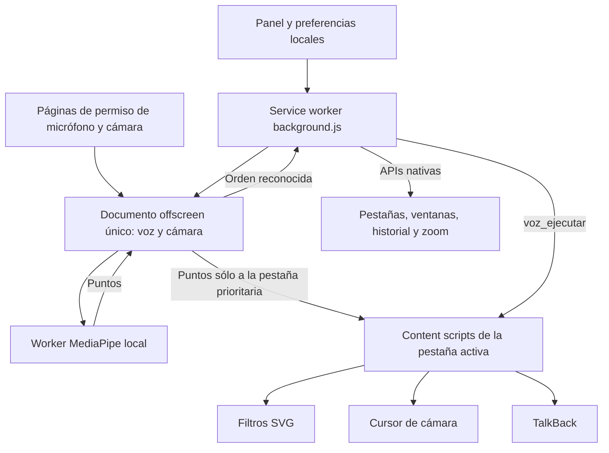

<p align="center">
  
</p>

# AdaptaPE Base: navegar sin manos en Chrome con voz y cámara

AdaptaPE Base es la **edición completa** de la extensión AdaptaPE para Google Chrome y otros navegadores Chromium de escritorio. Permite navegar por la web sin usar ratón ni teclado: das órdenes con la voz, mueves un cursor con la cabeza, un brazo, una mano o un muñón delante de la cámara, escuchas el elemento que señalas y cambias los colores de las páginas.

- **Versión del código:** 13.0 (Manifest V3).
- **Navegador mínimo:** Chromium 119 (`minimum_chrome_version` del manifest).
- **Instalar:** [AdaptaPE en Chrome Web Store](https://chromewebstore.google.com/detail/haglphebolbegbchdkgejkoblocehogp?utm_source=item-share-cb) o desde este repositorio ([instrucciones](#instalación)).
- **Sitio oficial:** [adaptape.cc](https://www.adaptape.cc) (también [adaptape.thealejo-dev.cc](https://adaptape.thealejo-dev.cc), que es el enlace del manifest y de la Nueva pestaña).
- **Código fuente:** [TheAlejo160/Adapta-PE](https://github.com/TheAlejo160/Adapta-PE).

## Contenido

- [Para quién es esta edición](#para-quién-es-esta-edición)
- [Requisitos](#requisitos)
- [Instalación](#instalación)
- [Primer uso: bienvenida y panel](#primer-uso-bienvenida-y-panel)
- [Tutoriales](#tutoriales)
- [Catálogo de órdenes de voz](#catálogo-de-órdenes-de-voz)
- [Cómo funciona](#cómo-funciona)
- [Privacidad](#privacidad)
- [Solución de problemas](#solución-de-problemas)
- [Desarrollo y pruebas](#desarrollo-y-pruebas)
- [Backend Python opcional (simulado)](#backend-python-opcional-simulado)
- [Trabajo futuro](#trabajo-futuro)
- [Proyectos de la familia AdaptaPE](#proyectos-de-la-familia-adaptape)
- [Autoría, licencia y uso de IA](#autoría-licencia-y-uso-de-ia)

## Para quién es esta edición

Base está pensada para personas que necesitan **control manos libres completo** del navegador:

- Personas con movilidad limitada, temblores, ausencia de extremidades o dificultad para movimientos precisos. Pueden combinar la voz con el seguimiento de la parte del cuerpo que les resulte más cómoda: cabeza, torso, brazos, manos, puños o un muñón.
- Personas con necesidades visuales que quieren escuchar el texto del elemento señalado o cambiar los colores de las páginas.
- Quienes acompañan a otra persona en la configuración inicial (conceder permisos, fijar el icono).

El cursor por cámara **necesita una cámara web**. La voz necesita micrófono y un navegador con reconocimiento de voz disponible. Cada módulo se activa por separado: puedes usar sólo la voz o sólo los filtros.

### Base o Lite

| Función | Base (este repositorio) | [Lite](https://github.com/TheAlejo160/Adapta-PE-Lite) |
| --- | --- | --- |
| Voz global, navegación, búsquedas y dictado | Sí | Sí |
| Órdenes e interfaz en español, inglés, portugués, alemán, francés e italiano | Sí | Sí |
| Siete filtros de color | Sí | Sí |
| Mascotas Tinku, Cuchu y Yati | Sí | Sí |
| Nueva pestaña de AdaptaPE | Sí | Sí |
| Lectura en voz alta (TalkBack) | Sí | No |
| Cursor con cámara, clic por permanencia, pinza, boca y puño | Sí | No |
| Modelos de visión MediaPipe incluidos en el paquete | Sí | No |

Elige **Lite** si tu equipo es modesto o no necesitas cámara ni lectura en voz alta. Cada edición es una extensión independiente, con sus propias preferencias y su propio permiso de micrófono. Si instalas las dos, **activa Control por voz sólo en una**.

La utilidad real depende de la movilidad disponible, la iluminación, el reconocimiento de voz y la estructura de cada web. Las pruebas de desarrollo no acreditan compatibilidad universal con todas las personas, amputaciones o ayudas técnicas.

## Requisitos

- Google Chrome u otro navegador Chromium de escritorio, **versión 119 o posterior**.
- Micrófono, para Control por voz. El reconocimiento usa la API de voz del navegador (`webkitSpeechRecognition`), que puede necesitar conexión a internet.
- Cámara web, para Cursor con cámara. Funciona mejor con buena iluminación.
- Voces instaladas en el sistema, para la lectura en voz alta y las confirmaciones habladas (`chrome.tts`).
- No necesitas Node, Python ni compilar nada para usar la extensión.

## Instalación

### Desde Chrome Web Store

1. Abre [AdaptaPE en Chrome Web Store](https://chromewebstore.google.com/detail/haglphebolbegbchdkgejkoblocehogp?utm_source=item-share-cb).
2. Pulsa **Añadir a Chrome** y confirma los permisos.
3. Se abre la [página de bienvenida](#primer-uso-bienvenida-y-panel).

La versión publicada en la tienda puede ir por detrás del código de este repositorio. Este README describe el código de esta carpeta.

### Desde el repositorio

1. Descarga el código. Con Git:

   ```sh
   git clone https://github.com/TheAlejo160/Adapta-PE.git
   ```

   Sin Git: en GitHub pulsa **Code → Download ZIP** y extrae el archivo en una carpeta permanente.
2. Abre `chrome://extensions` en Chrome.
3. Activa **Modo de desarrollador** (arriba a la derecha).
4. Pulsa **Cargar descomprimida** y elige **la carpeta que contiene directamente `manifest.json`**: normalmente `Adapta-PE` si clonaste o `Adapta-PE-main` si extrajiste el ZIP. No elijas el ZIP ni una carpeta superior.
5. Comprueba que aparece **AdaptaPE** habilitada. Se abre la página de bienvenida.
6. Fija el icono: pulsa el icono de extensiones (pieza de rompecabezas) junto a la barra de direcciones y luego el alfiler de AdaptaPE.

No muevas ni borres la carpeta mientras la uses: Chrome la lee en cada arranque. Las pestañas que ya estaban abiertas reciben la extensión automáticamente, sin recargarlas.

Desde la terminal de macOS, `open -a "Google Chrome" 'chrome://extensions/'` abre el administrador. Cargar la carpeta siempre exige confirmarlo en el navegador; clonar no instala la extensión por sí solo.

### Edge y Brave

El manifest no tiene código específico para otros navegadores. Los pasos son los mismos con su página de extensiones:

- **Microsoft Edge:** `edge://extensions`, activa **Modo de desarrollador** y pulsa **Cargar desempaquetada**.
- **Brave:** `brave://extensions`, activa **Modo de desarrollador** y pulsa **Cargar descomprimida**.

Ser Chromium no garantiza que exista el servicio de reconocimiento de voz: el navegador puede exponer la API y no transcribir nada. Las pruebas automáticas usan Google Chrome; Edge y Brave no se han verificado. Si la voz no responde, prueba en Google Chrome.

### Actualizar una instalación desde el repositorio

```sh
cd Adapta-PE
git pull --ff-only
```

Después pulsa el botón de recarga de AdaptaPE en `chrome://extensions` una vez, para que Chrome lea los archivos y permisos nuevos. Las webs abiertas se reconectan solas.

## Primer uso: bienvenida y panel

Al instalar se abre **«Ya puedes usar AdaptaPE»** (`bienvenida.html`) con tres interruptores: **Control por voz**, **Cursor con cámara** y **Lectura en voz alta**. Cada uno guarda la preferencia sólo cuando lo pulsas. Si Chrome pide permiso para el micrófono o la cámara, elige **Permitir**.

Después todo se ajusta desde el panel **Ayudas de AdaptaPE** (el icono de la barra). El panel muestra cada módulo con su estado **Activado / Desactivado**:

| Sección del panel | Qué controla |
| --- | --- |
| **Lectura en voz alta** | TalkBack: escucha el elemento que señalas. |
| **Control por voz** | Escucha global de órdenes. Incluye **Idioma**, **Órdenes y micrófono** y el botón **Configurar micrófono**. |
| **Filtros de color** | Siete filtros, **Sin filtro** y **Quitar filtro**. |
| **Cursor con cámara** | Activa la cámara y la pregunta **«¿Qué quieres usar para moverlo?»** con los tres modos. Incluye la ayuda **Cómo mover y hacer clic**. |
| **Tu mascota** | **Sin mascota**, **Tinku · gallito de las rocas**, **Cuchu · cuy** o **Yati · llama**. |

Los ajustes se guardan automáticamente en el navegador; el panel avisa si no pudo guardarlos.

## Tutoriales

Los ejemplos están en español. Cambia el nombre del campo, botón o producto por el que realmente aparezca en la web.

### 1. Activar la voz y conceder el micrófono

1. Abre el panel y activa **Control por voz**.
2. Si la extensión aún no tiene permiso, se abre la página **«Permitir el micrófono»** (`voz/permisos.html`). Pulsa **Permitir micrófono** y acepta el aviso de Chrome.
3. Puedes abrir esa página en cualquier momento con **Configurar micrófono**, incluso con la voz apagada.

El permiso pertenece a la extensión, no a cada sitio: lo concedes una vez y sirve en todas las pestañas y ventanas. **Desactivar Control por voz libera el micrófono.** Si denegaste el permiso, corrígelo y vuelve a activar Control por voz.

### 2. Tu primera orden: «Computadora, …»

1. Di **«Computadora, abre YouTube»** en una sola frase.
2. También puedes decir sólo **«Computadora»**, esperar el pitido y dar la orden dentro de los **8 segundos** siguientes.
3. Repite «Computadora» antes de cada orden nueva.

En las webs aparece un indicador con el estado de la escucha. Di **«Computadora, ayuda»** para escuchar un resumen de órdenes. No hace falta un imperativo exacto: «Computadora, por favor ábreme YouTube pe» también funciona (ver [Formas de decir la misma orden](#formas-de-decir-la-misma-orden)).

### 3. Abrir y buscar sitios

- «Computadora, abre Wikipedia» abre la portada del sitio.
- «Computadora, busca accesibilidad en Wikipedia» busca dentro de esa plataforma.
- «Computadora, busca gatos» busca en la plataforma actual si la conoce; si no, en un buscador visible de la página y, por último, en Google.
- Añade «en una nueva pestaña» o «en otra ventana» al final para elegir el destino.
- «Computadora, abre example.com» abre cualquier dominio o URL HTTP/HTTPS.

El catálogo de sitios está en [Sitios y búsquedas](#sitios-y-búsquedas).

### 4. Dictar y enviar un formulario

1. «Computadora, enfoca correo» pone el foco en el campo cuya etiqueta, nombre accesible o texto de ayuda coincide.
2. «Computadora, escribe Hola Perú» inserta el texto tal cual, con acentos y mayúsculas.
3. «Computadora, borra el texto» vacía el campo si te equivocas.
4. «Computadora, enviar formulario» o «Computadora, presiona enter» envía el formulario, respetando su validación.

El dictado **no escribe en campos de contraseña**. Revisa el contenido antes de enviar: la orden ejecuta la acción real del sitio.

### 5. Seleccionar y dar clic por voz

1. «Computadora, selecciona zapatos azules» busca el elemento por su nombre visible o accesible, lo acerca a la vista, lo rodea con un contorno amarillo y anuncia la selección. **Seleccionar no hace clic.** También vale «resalta…».
2. «Computadora, dale clic» (o «hazle clic», «activa lo seleccionado») lo activa una vez.
3. «Computadora, cancelar selección» retira el resaltado.

Para activar algo directamente, di «Computadora, clic en Contacto». Si el elemento seleccionado desaparece, se deshabilita o queda oculto, la confirmación no activa otro control: vuelve a seleccionarlo. La búsqueda usa texto, etiquetas y estructura accesible; no reconoce productos por su imagen.

### 6. Activar la cámara y elegir cómo mover el cursor

1. Abre una web normal (no una página `chrome://`).
2. Activa **Cursor con cámara** en el panel, o di «Computadora, activar cursor» con la voz ya activa.
3. La primera vez se abre la página **«Permitir la cámara»**. Pulsa **Permitir cámara** (el botón tiene el foco: basta con Enter) y acepta el aviso de Chrome. Después vuelves automáticamente a tu página. No se vuelve a pedir al cambiar de sitio.
4. En **«¿Qué quieres usar para moverlo?»** elige un modo:

| Modo | Qué sigue | Cómo empieza |
| --- | --- | --- |
| **Cabeza / torso (predeterminado)** | El rostro; si se pierde, puntos corporales visibles. | **Calibra tu postura** durante un segundo aproximadamente: quédate en tu posición cómoda. Muévete desde ahí para desplazar el cursor y vuelve para detenerlo. |
| **Brazos, manos o puños** | La muñeca de la mano abierta o el puño; si no se ve, el codo. Excluye cabeza y torso. | **Sin calibración.** La primera posición detectada es el reposo de un joystick invisible. Desplaza un poco la mano en cualquier dirección y mantenla para seguir moviendo; vuelve al reposo para parar. También puedes señalar con uno a cuatro dedos alineados. |
| **Muñón / mano parcial** | Una textura visible en movimiento (piel, ropa, vendaje), sin reconocer anatomía. | **Sin calibración.** Un movimiento breve adquiere la textura. Desplázala para mover y vuelve para detener; un giro pequeño mantenido aporta dirección horizontal. |

Una burbuja informativa muestra la vista de la cámara; no tiene botones. Una línea celeste indica la dirección del gesto en los modos de extremidades. Cambiar de modo con la cámara activa no recarga la página ni vuelve a pedir permiso. Di «Computadora, recalibrar» si en cabeza/torso tu postura cambió.

### 7. Hacer clic sin manos: permanencia, pinza, boca y puño

| Método | Modo | Cómo |
| --- | --- | --- |
| **Permanencia (dwell)** | Todos | Sal de la zona de atracción al menos 180 ms, vuelve a la zona segura y quédate **1 segundo** sobre el mismo objetivo. Para otro clic repite la salida y el regreso. |
| **Pinza** | Brazos, manos o puños | Junta pulgar e índice y suéltalos antes de 0,7 s: clic. Mantén la pinza 0,7 s: clic derecho. La muñeca debe verse dentro del cuadro. |
| **Boca** | Cabeza / torso | Abre bien la boca unos 0,3 s y ciérrala: clic al cerrar. Más de 1,5 s abierta (bostezo) no hace clic. |
| **Puño + permanencia** | Brazos, manos o puños | Muestra la mano abierta, luego cierra el puño y mantenlo. El cursor se detiene en el centro seguro y hace clic tras 1 segundo sobre el mismo objetivo. Abre la mano para cancelar. |
| **Voz** | Todos | «Computadora, clic», «clic derecho» o «siguiente clic derecho» (prepara el próximo clic como derecho). |

Mientras la pinza o la boca están activas el cursor se queda quieto. Cada gesto hace como máximo un clic. Muñón / mano parcial no tiene gesto de clic: usa permanencia o voz. El clic con la boca no tiene interruptor propio: hablar con la boca muy abierta podría producir un clic. **Los umbrales de pinza, boca y puño se han comprobado con datos sintéticos y fotografías de prueba, no con cámaras ni personas reales.**

### 8. Escuchar lo que señalas (TalkBack)

1. Activa **Lectura en voz alta** en el panel.
2. Pasa el ratón o el cursor de cámara sobre un elemento.
3. Tras **300 ms** se lee su nombre accesible, texto alternativo o contenido, y se marca con un contorno.

Di «Computadora, cállate» para detener la lectura. Es una lectura por puntero, no un lector de pantalla completo: no ofrece navegación por teclado ni describe imágenes sin texto alternativo.

### 9. Filtros de color

Elige uno en **Filtros de color**: Protanomalía, Protanopía, Deuteranomalía, Deuteranopía, Tritanomalía, Tritanopía o Acromatopsia (escala de grises). El panel muestra **Activo:** con el nombre del filtro. **Quitar filtro** o **Sin filtro** lo retira.

El filtro se aplica también en pestañas de fondo, en marcos incrustados y en pantalla completa de juegos y reproductores (Canvas, WebGL y vídeo), sin aplicarse dos veces. Puedes cambiarlo sin recargar ni salir de pantalla completa. Son transformaciones visuales fijas: no diagnostican ni corrigen médicamente el daltonismo.

### 10. Mascotas Tinku, Cuchu y Yati

1. Elige una en **Tu mascota**, o di «Computadora, mascota Tinku» (o Cuchu, Yati).
2. Aparece abajo a la derecha y mira tu cursor, incluido el de cámara.
3. Para moverla, arrastra su nombre, o enfócalo con Tab y usa las flechas. La posición se recuerda.
4. «Saluda mascota», «duerme mascota», «despierta mascota» y «oculta mascota» controlan sus animaciones.

La mascota reacciona cuando AdaptaPE escucha, falla o habla. Respeta «reducir movimiento» del sistema. **Sin mascota** la desactiva.

### 11. Nueva pestaña y temas

AdaptaPE sustituye la Nueva pestaña de Chrome por la suya. Allí funcionan la voz, el cursor de cámara, TalkBack, los filtros y la mascota, cosa que la página de Chrome no permite.

- **Buscar** usa tu buscador predeterminado. El botón del micrófono sólo recuerda la orden «Computadora, busca…»: no abre un segundo micrófono.
- Arriba a la derecha: **Gmail**, **Imágenes**, el menú de apps de Google y el enlace a tu cuenta (icono genérico; la extensión no lee tu foto).
- **Modo IA** abre tu consulta en el Modo IA de Google; **Lens** abre images.google.com.
- Accesos directos a los sitios más visitados y tu barra de marcadores.
- **Personalizar**: temas Sistema, Claro, Oscuro, Alto contraste, Pacífico, Selva y Cielo; color de acento; e imagen de fondo de tu equipo (se reduce a 1.920 px y unos 750 kB y se guarda sólo en este navegador). El selector de imagen exige teclado o ratón: Chrome no lo abre con clics de la cámara ni de la voz.

Chrome no deja que una extensión lea su tema, así que esta página no lo sigue. Si Chrome pregunta si quieres conservar el cambio de la Nueva pestaña, elige conservarlo: volver a la anterior puede desactivar AdaptaPE.

### 12. Cambiar el idioma

En **Control por voz → Idioma** elige entre **Automático (idioma de Chrome)**, siete variantes de español, inglés (Estados Unidos o Reino Unido), portugués (Brasil o Portugal), alemán, francés e italiano. La elección cambia el reconocimiento y **toda la interfaz**: panel, bienvenida, permisos, indicadores, mascota, vista de cámara y respuestas habladas. Se aplica en las páginas abiertas sin recargarlas.

**«Computadora» funciona siempre.** Además se acepta la palabra del idioma elegido: «Computer» (inglés, alemán, italiano), «Computador» (portugués) u «Ordinateur» (francés). Ver [Órdenes en otros idiomas](#órdenes-en-otros-idiomas).

## Catálogo de órdenes de voz

Di cada orden después de **«Computadora»** o dentro de su ventana de 8 segundos.

### Navegación, pestañas y ventanas

| Orden y variantes | Resultado |
| --- | --- |
| `abre YouTube`, `ejecuta Netflix`, `visita GitHub` | Abre la portada de un sitio del catálogo. |
| `abre example.com`, `abre https://example.com` | Abre un dominio o URL HTTP/HTTPS. |
| `busca Perú en YouTube`, `busca en Wikipedia accesibilidad` | Busca en la plataforma indicada; admite `consulta`, `encuentra`, `investiga` y `haz una búsqueda de…`. |
| `busca accesibilidad` | Usa la plataforma actual si tiene búsqueda en el catálogo; si no, un buscador visible de la página y, por último, Google. |
| `abre YouTube en una nueva pestaña`, `busca Perú en otra ventana` | El modificador final elige el destino. Sin modificador se usa la pestaña actual. |
| `busca en YouTube` (sin consulta) | Pregunta qué quieres buscar. |
| `nueva pestaña`, `otra pestaña`, `abre una nueva ventana` | Crea una pestaña o ventana nueva. |
| `cierra esta pestaña`, `cerrar ventana` | Cierra la pestaña o la ventana. |
| `cierra las otras pestañas`, `deja solo esta pestaña` | Cierra las demás pestañas de la ventana y conserva las fijadas. |
| `duplica la pestaña` | Duplica la pestaña actual. |
| `pestaña 3`, `ve a la pestaña dos`, `la tercera pestaña`, `última pestaña` | Activa esa pestaña contando desde la izquierda (del 1 al 10 con palabras). |
| `siguiente pestaña`, `pestaña de la derecha`; `pestaña anterior`, `pestaña de la izquierda` | Recorre las pestañas de la ventana, volviendo al extremo opuesto al final. |
| `atrás`, `volver`, `regresa`; `adelante`, `avanza` | Navega por el historial. |
| `recarga`, `actualiza la página`, `vuelve a cargar` | Recarga la pestaña. |
| `silencia la pestaña`, `mutea la pestaña`, `quita el sonido`, `sin sonido` | Silencia la pestaña. |
| `activa el sonido`, `quita el silencio`, `desmutea` | Devuelve el sonido. |
| `pantalla completa`, `pon pantalla completa` | Pone la ventana en pantalla completa. |
| `sal de pantalla completa`, `pantalla normal` | Devuelve la ventana a su estado anterior (normal o maximizada). |
| `aumenta zoom`, `acerca`, `más grande`; `reduce zoom`, `aleja`, `achica`; `zoom normal` | Zoom en pasos de 10 puntos entre 25 % y 500 %, o vuelta al 100 %. |

Cuando una apertura o búsqueda pide otra ventana, se intenta situarla en un monitor secundario. «Nueva ventana» sin URL crea la ventana nativa.

### Página, formularios y medios

| Orden y variantes | Resultado |
| --- | --- |
| `baja`, `abajo`, `sube`, `arriba`, `scrollea pa abajo` | Desplaza el 70 % de la pantalla. `sube un poco` y `baja un poquito` usan 25 %; `baja más`, 95 %. |
| `ve al inicio`, `hasta arriba`, `ir al final`, `baja hasta el final` | Va al principio o al final. |
| `enfoca correo`, `enfoca nombre` | Enfoca un campo visible por etiqueta, nombre accesible o placeholder. |
| `escribe Hola Perú`, `dicta…`, `introduce…` | Inserta texto en el campo enfocado, incluidos editores `contenteditable`. |
| `borra el texto`, `limpia el campo` | Vacía el campo enfocado. |
| `presiona enter`, `pulsa enter`, `enviar formulario` | Envía el formulario del campo enfocado, respetando su validación. |
| `clic en Contacto`, `haz clic en Guardar`, `pulsa…` | Activa un enlace o control visible por su nombre. `abrir [nombre]` también puede activar botones o enlaces. |
| `selecciona zapatos azules`, `seleccionar…`, `resalta…` | Resalta un elemento y anuncia la selección, sin hacer clic. |
| `dale clic`, `hazle clic`, `activa lo seleccionado` | Activa la selección una vez. |
| `clic`, `haz clic` | Activa la selección si existe; si no, el cursor de cámara o el elemento enfocado. |
| `reproduce el video`, `continuar video`, `pausa el audio` | Reproduce o pausa el primer vídeo o audio. La web puede exigir una interacción física. |
| `cancela`, `cancelar`, `olvídalo` | Cancela la orden pendiente y retira la selección. |
| `ayuda`, `qué puedo decir`, `qué comandos hay`, `qué puedes hacer` | Lee y muestra un resumen de órdenes. |
| `cállate`, `silencio`, `basta`, `deja de leer`, `para de hablar` | Detiene la lectura en voz alta. |

El dictado conserva acentos, mayúsculas y signos. No inserta ni borra texto en campos de contraseña, incluidos los revelados o los editores con `autocomplete="current-password"` o `"new-password"`; esta protección actúa después del reconocimiento y no evita que el servicio de voz procese lo pronunciado. Las palabras de navegación dentro de un dictado o una búsqueda no se ejecutan como órdenes.

### Cursor con cámara

| Orden | Acción |
| --- | --- |
| `activar cursor`, `activa el cursor`, `enciende la cámara`; `desactivar cursor`, `apaga el mouse` | Activa o apaga la cámara. |
| `postura cómoda`, `calibrar cursor`, `recalibrar`, `centrar cursor` | Cabeza/torso aprende de nuevo el reposo. En extremidades cancela el clic pendiente y confirma el centro fijo. |
| `pausar cursor`, `pausa el cursor`, `descansar`; `reanudar cursor`, `continuar cursor` | Pausa o reanuda movimiento y clic sin apagar la cámara. |
| `control cabeza`, `control rostro`, `control torso` | Modo Cabeza / torso. |
| `control manos`, `control brazos`, `control extremidades`, `control puños` | Modo Brazos, manos o puños. |
| `control zona libre`, `control muñón`, `control mano parcial` | Modo Muñón / mano parcial. |
| `activar temblor`, `ajustar temblor`, `desactivar temblor` | Amplía o restablece la zona segura. Repetir la activación no la desactiva. |
| `movimientos pequeños`, `movilidad reducida`, `movimientos normales` | Ajusta la amplitud de movimiento necesaria. |
| `cursor más lento`, `cursor más rápido` | Ajusta la velocidad. |
| `clic`, `da clic`, `dale clic`, `clic derecho`, `anticlic`, `menú contextual` | Clic con el cursor. «da clic» y «dale clic» priorizan la selección por voz. |
| `siguiente clic derecho`, `activar clic derecho` | El próximo clic por permanencia, pinza corta o boca será derecho. |
| `cancelar clic` | Cancela la fijación y el menú propio, y vuelve al clic izquierdo. |

Las órdenes de ajuste necesitan la cámara activa. El clic derecho envía `contextmenu`: si la web no lo usa, aparece un menú propio de AdaptaPE. Los eventos sintéticos no abren el menú nativo de Chrome.

### Mascotas

`mascota Tinku`, `mascota Cuchu`, `mascota Yati`, `saluda mascota`, `duerme mascota`, `despierta mascota`, `oculta mascota`. Los nombres toleran separaciones y letras repetidas («Y Atti», «Tin cu», «Cu chu») y variantes como Tincu, Tinko, Kuchu, Cucho, Yaty y Yate, sólo dentro de esta orden.

### Formas de decir la misma orden

Antes de interpretar la orden se retiran cortesías y muletillas, y el primer verbo pasa a su forma canónica. El texto dictado y las consultas no se alteran.

| Tipo | Ejemplos aceptados |
| --- | --- |
| Cortesía al inicio | «por favor», «porfa», «porfis», «puedes», «podrías», «puede», «podés», «me puedes», «quiero», «quiero que», «necesito que», «me haces el favor de», «hazme el favor de», «ayúdame a», «favor de», «intenta», «vamos a». |
| Muletillas al inicio | «oye», «oe», «oiga», «ya», «ya pe», «a ver», «bueno», «mira», «este», «ok», «vale». |
| Al final | «pe», «pues», «porfa», «por favor». |
| Usted, voseo, subjuntivo y pronombres | «ábrame», «abrí», «me abres», «quiero que abras», «búscame», «cierre», «cerrá», «bájale», «súbele», «volvé», «hágale clic», «dele clic». |
| Perú y Latinoamérica | «aplasta» y «aprieta» (presiona), «clickea», «cliquea» y «toca» (pulsa), «mutea», «scrollea», «pa abajo», «anda a», «googlea». |
| Abrir sitios | «llévame a YouTube», «ponme YouTube», «entra al YouTube», «abre el YouTube». |

Se ignoran «¿» y «¡» iniciales y la puntuación final. «Computadora, por favor» sola equivale a «Computadora»: suena el pitido y espera la orden.

### Sitios y búsquedas

El catálogo de `sitios.js` incluye Google, YouTube, Mercado Libre, Amazon, Wikipedia, Facebook, Instagram, X/Twitter, Reddit, Netflix, Twitch, GitHub, ChatGPT, Claude, Gemini, Canvas, Gmail, Outlook/Hotmail, WhatsApp, Telegram, Google Drive, Google Docs, Google Maps, LinkedIn, TikTok, Spotify, Bing y DuckDuckGo. Acepta alias como «You Tube», «Git Hub», «Chat GPT», «equis», «tuiter», «wasap», «guasap», «WhatsApp Web», «face», «feis», «insta», «wiki» y «mapas».

Las búsquedas usan la ruta de cada plataforma; si no tiene, se busca en Google con `site:dominio`. Esto **no consulta tu correo, documentos ni contenido privado**. Canvas usa una portada genérica: para tu institución, abre su dominio. Un nombre desconocido en «abre…» se busca entre los controles de la página, no en Google.

### Órdenes en otros idiomas

| Idioma | Activación | Ejemplos |
| --- | --- | --- |
| Español | «Computadora», «Computadoras», «Computador» | Todas las anteriores. |
| Inglés | «Computer» | «open YouTube», «search Funny Cats on YouTube in a new tab», «scroll down a bit», «new tab», «close tab», «go to tab 3», «go back», «click», «click on Contact», «write Hello World», «mute tab», «full screen», «help», «cancel». |
| Portugués | «Computador» | «abre o YouTube», «pesquisa gatos no YouTube», «rola para baixo», «nova aba», «fecha a aba», «volta», «clica em Contato», «escreve Olá», «tela cheia», «ajuda». |
| Alemán | «Computer» | «öffne YouTube» o «YouTube öffnen», «suche Katzen auf YouTube», «nach unten», «neuer Tab», «schließe den Tab», «zurück», «klicke auf Kontakt», «schreibe Hallo», «Vollbild», «Hilfe». |
| Francés | «Ordinateur» | «ouvre YouTube», «cherche chats sur YouTube», «descends», «nouvel onglet», «ferme l'onglet», «retour», «clique sur Contact», «écris Bonjour», «plein écran», «aide». |
| Italiano | «Computer» | «apri YouTube», «cerca gatti su YouTube», «scorri giù», «nuova scheda», «chiudi la scheda», «indietro», «clicca su Contatto», «scrivi Ciao», «schermo intero», «aiuto». |

| Idioma | Mascota | Pausar / reanudar el cursor |
| --- | --- | --- |
| Inglés | `pet Yati`, `greet pet`, `sleep pet`, `wake pet`, `hide pet` | `pause cursor`, `resume cursor` |
| Portugués | `mascote Yati`, `cumprimenta mascote`, `dorme mascote`, `acorda mascote`, `oculta mascote` | `pausa cursor`, `retoma cursor` |
| Alemán | `Haustier Yati`, `Haustier grüßen`, `Haustier schlafen legen`, `Haustier wecken`, `Haustier ausblenden` | `Cursor pausieren`, `Cursor fortsetzen` |
| Francés | `mascotte Yati`, `salue mascotte`, `endors mascotte`, `réveille mascotte`, `cache mascotte` | `pause curseur`, `reprends curseur` |
| Italiano | `mascotte Yati`, `saluta mascotte`, `addormenta mascotte`, `sveglia mascotte`, `nascondi mascotte` | `pausa cursore`, `riprendi cursore` |

Las órdenes de otros idiomas se traducen una vez a la orden canónica en español que interpreta el mismo parser. Dictado, consultas, nombres de controles y nombres de mascotas no se traducen. «Computer» es frecuente en inglés, alemán e italiano y puede activar órdenes por error. No se aceptan «compu» ni «ordenador» para evitar falsos disparos.

**Automático** usa el primer idioma admitido de `navigator.languages`, `navigator.language` y el idioma de la interfaz de Chrome; si ninguno coincide, español de Perú (`es-PE`). La elección se guarda en la clave `idiomaVoz`. El nombre AdaptaPE, los personajes y la licencia no cambian. Los metadatos de Chrome (descripción y título del icono) vienen de `_locales/*/messages.json`.

## Cómo funciona

La extensión está escrita en HTML, CSS y JavaScript nativo, sin frameworks. Manifest V3 reparte el trabajo en cuatro contextos:



1. **Service worker (`background.js`).** Gestiona pestañas, ventanas, historial, zoom y síntesis de voz. `sincronizarVoz()` crea o cierra el documento offscreen de forma serializada. `sincronizarPaginas()` decide qué pestaña tiene la prioridad (la activa de la ventana enfocada) y reconecta webs ya abiertas con `chrome.scripting`, sin recargarlas.
2. **Documento offscreen único (`voz/escucha.html`).** Es el único lugar donde se escucha el micrófono (`voz/escucha.js`) y se captura la cámara (`voz/camara.js`). Una sola captura sirve a todas las pestañas y no depende del foco de ninguna página. Apagar voz y cámara cierra el documento.
3. **Worker de visión (`vision/trabajador.js`).** Ejecuta MediaPipe en CPU con modelos y WASM incluidos en el paquete: rostro, Pose Lite y manos. Si la inferencia tarda, una carga adaptativa reduce la resolución y descansa entre imágenes. Los puntos sólo llegan a la pestaña prioritaria.
4. **Content scripts.** `content_script.js` instancia `VoiceAssistant` (parser de órdenes de página, sin micrófono), `KineticEngine` (física, calibración, clics), `TalkBack`, `FiltrosDaltonismo` y la mascota. Una segunda regla carga sólo los filtros (`filtros_frames.js`) en todos los marcos.

### Recorrido de una orden de voz

1. El reconocedor del documento offscreen agrupa resultados finales durante 550 ms y provisionales estables durante 1.200 ms, sin duplicar órdenes.
2. Tras la palabra de activación, `prepararComando()` quita cortesías y traduce a la orden canónica en español.
3. El worker toma la pestaña activa una sola vez por frase y le envía `voz_ejecutar`.
4. Si la página está protegida (`chrome://`, Chrome Web Store), el worker usa el parser central sólo para operaciones nativas: abrir, buscar, pestañas, ventanas, historial y zoom.
5. El reconocimiento se reinicia solo al terminar, con esperas de 300 ms a 5 s según los fallos.

### Límites en páginas protegidas

Chrome no permite content scripts en `chrome://`, la Chrome Web Store y otras páginas internas. Allí no hay cursor, TalkBack, filtros, dictado, clic ni desplazamiento, y la inferencia de cámara se pausa. La voz sigue funcionando para las operaciones nativas. AdaptaPE **no escribe en la barra de direcciones ni pulsa botones de la interfaz de Chrome**. La Nueva pestaña propia es la excepción: es una página de la extensión y carga todos los módulos.

### Archivos principales

| Archivo | Función |
| --- | --- |
| `manifest.json` | Versión, permisos, service worker, orden de inyección y Chromium 119 mínimo. |
| `popup.html` / `popup.js` / `voz/popup.js` | Panel, preferencias en `chrome.storage.local`, estado de escucha y **Configurar micrófono**. |
| `bienvenida.html` / `bienvenida.js` | Página que el worker abre al instalar. |
| `voz/permisos.html` / `voz/permisos.js` | Autorización visible de micrófono o cámara. |
| `voz/escucha.html` / `voz/escucha.js` / `voz/camara.js` | Documento offscreen: reconocedor único y captura de cámara. |
| `vision/trabajador.js` | Worker MediaPipe privado, con modelos y WASM locales. |
| `background.js` | Service worker: `ejecutarAccion()`, `gestionarAperturaURL()`, `sincronizarVoz()`, `sincronizarPaginas()`, `idiomaVoz()`. |
| `sitios.js` | Catálogo de sitios, alias e `IdiomasVoz` (activación, ayuda, cortesías y reglas por idioma). |
| `textos.js` / `textos_paginas.js` / `_locales/` | Textos de la interfaz en seis idiomas, sin servicio de traducción externo. |
| `classes/VoiceAssistant.js` | Reconocimiento (sólo offscreen) y parser de órdenes de página, selección y dictado. |
| `classes/KineticEngine.js` | Cursor de cámara: calibración, joystick, física, permanencia, pinza, boca, puño y menú contextual. |
| `classes/TalkBack.js` | Lectura por puntero con debounce de 300 ms. |
| `classes/FiltrosDaltonismo.js` / `filtros_frames.js` | Filtros SVG en la página, marcos y pantalla completa. |
| `mascotas/` | Adaptador de mascota, motor del SDK Mascota-Modular-Adapta-PE y sprites WebP. |
| `nueva_pestana*.{html,js,css}` | Nueva pestaña propia y sus temas. |
| `content_script.js` | Controlador de página: instancia módulos, aplica preferencias y se retira si la extensión se desactiva. |
| `app.py` | Prototipo Flask opcional y simulado; no lo usa la extensión. |

Los detalles del cursor (umbrales, joystick, señal con dedos, carga adaptativa) están en [KINETICMOUSE.md](KINETICMOUSE.md). Las reglas internas para quien desarrolla están en [CLAUDE.md](CLAUDE.md).

### Permisos del manifest

| Permiso | Uso |
| --- | --- |
| `storage` | Preferencias locales. |
| `tabs` | Pestaña de destino, navegación y gestión de pestañas. |
| `scripting` | Conectar los módulos en webs ya abiertas sin recargarlas. |
| `offscreen` | Documento único de voz y cámara. |
| `tts` | Lectura en voz alta y confirmaciones habladas. |
| `system.display` | Elegir monitor al abrir una URL en otra ventana. |
| `search` | Buscar con el buscador predeterminado desde la Nueva pestaña. |
| `topSites` | Accesos directos de la Nueva pestaña. |
| `bookmarks` | Barra de marcadores de la Nueva pestaña (sólo lectura). |
| `favicon` | Iconos de accesos directos y marcadores. |
| `<all_urls>` | Inyectar los módulos en las webs donde Chrome lo permite. |

El micrófono y la cámara no son permisos del manifest: se conceden a la extensión con las páginas de autorización. La política de seguridad incluye `wasm-unsafe-eval` para el runtime local de visión.

## Privacidad

- **No se guarda audio, imágenes de cámara ni transcripciones.** El estado del indicador vive en memoria.
- **La cámara se procesa en tu equipo.** Los fotogramas no salen de la extensión; MediaPipe, sus modelos y el WASM vienen en el paquete, sin CDN ni servidor. Los modelos de visión no son accesibles desde las webs.
- **La voz puede procesarse en línea.** El reconocimiento del navegador puede enviar audio a su servicio. No se garantiza voz sin conexión.
- Se guardan sólo preferencias en `chrome.storage.local`: `voz`, `ojos`, `talkback`, `daltonismo`, `idiomaVoz`, `mascota`, `posicionMascota`, `temaNuevaPestana` y `ajustesCineticos` (modo, temblor, velocidad y amplitud; nunca postura ni imágenes).
- La marca `data-adapta-extension="true"` sólo se añade en el sitio oficial (`https://adaptape.cc`, `https://www.adaptape.cc` y `https://adaptape.thealejo-dev.cc`) y se retira al desactivar la extensión. Otros sitios no pueden detectarla así.
- Los recursos públicos de las mascotas se sirven con `use_dynamic_url`, para que una web no pueda sondear la extensión por su ID fijo.
- No se recopilan cookies, contraseñas ni historial. Las búsquedas envían la consulta al sitio elegido como una navegación normal.

AdaptaPE facilita acciones de accesibilidad; no garantiza acceso completo a cualquier sitio ni sustituye a un lector de pantalla del sistema.

## Solución de problemas

| Problema | Qué hacer |
| --- | --- |
| Micrófono denegado o «micrófono no disponible» | Pulsa **Configurar micrófono** y permite el acceso. Revisa también el permiso del sistema operativo para Chrome. Después desactiva y vuelve a activar **Control por voz**. |
| Repite órdenes o compite por el micrófono | Tienes Base y Lite instaladas con la voz activa en las dos. Desactiva **Control por voz** en una. |
| No reconoce nada en Edge o Brave | El navegador puede no ofrecer servicio de reconocimiento. Prueba en Google Chrome. |
| «Reconectando micrófono» no desaparece | Revisa la conexión a internet y el dispositivo de audio; el motor reintenta solo los fallos recuperables. |
| No funciona en `chrome://` o en la tienda | Son páginas protegidas: sólo hay órdenes nativas (abrir, buscar, pestañas, ventanas, historial, zoom). Ver [Límites en páginas protegidas](#límites-en-páginas-protegidas). |
| La cámara no arranca o está ocupada | Cierra otras apps o pestañas que usen la cámara, revisa el permiso de cámara del sistema para Chrome y apaga y enciende **Cursor con cámara**. |
| El cursor no calibra o pierde seguimiento | Mejora la iluminación. Sólo Cabeza / torso necesita postura estable o «recalibrar». En Muñón / mano parcial evita superficies uniformes y oclusiones. |
| No hace clic por permanencia | Sal de la zona de atracción, vuelve a la zona segura y quédate un segundo sobre el mismo objetivo. |
| La pinza no hace clic | Usa Brazos, manos o puños, separa primero pulgar e índice y mantén la muñeca visible. Un puño no cuenta como pinza. |
| La boca hace clics al hablar | Habla con la boca menos abierta o usa otro modo; ese clic no se desactiva por separado. |
| La extensión aparece desactivada tras abrir una pestaña | Chrome preguntó por el cambio de la Nueva pestaña y se eligió volver a la anterior, o una actualización con permisos nuevos espera tu aprobación. Actívala en `chrome://extensions`. |
| Aparece la Nueva pestaña de Chrome | Otra extensión la sustituye o AdaptaPE está desactivada. Revisa `chrome://extensions`. |
| No responde tras actualizar desde el repositorio | Recarga la extensión una vez en `chrome://extensions` y comprueba el acceso a sitios. |
| Un juego en pantalla completa queda sin filtro | Comprueba Chromium 119 o posterior y que la extensión tenga acceso al sitio y a sus marcos. |
| La voz se activa sola en inglés, alemán o italiano | «Computer» es una palabra frecuente. Elige un idioma español si sólo quieres «Computadora». |
| El service worker aparece «Inactivo» | Es normal en Manifest V3: despierta con cada evento. |

Los avisos de MediaPipe sobre XNNPACK, OpenGL o tensores de feedback son diagnósticos del SDK (la [advertencia NORM_RECT está reportada en su repositorio](https://github.com/google-ai-edge/mediapipe/issues/5639)). `ERR_BLOCKED_BY_CLIENT` o scripts como `ublock-filters.js` proceden de otras extensiones. Para reportar un fallo indica edición, versión, navegador, orden, estado del indicador y el error de la consola, sin datos privados.

## Desarrollo y pruebas

Reglas: JavaScript nativo, nombres y comentarios en español, IDs con prefijo `adapta-pe-` y `.catch(() => {})` en mensajes a pestañas. Lee [CLAUDE.md](CLAUDE.md) antes de cambiar código.

### Ejecutar las pruebas

Las pruebas usan sólo módulos nativos de Node (sin `npm install`) y buscan la edición Lite como carpeta hermana `extensiónLite`:

```sh
git clone https://github.com/TheAlejo160/Adapta-PE.git extensión
git clone https://github.com/TheAlejo160/Adapta-PE-Lite.git extensiónLite
cd extensión
node tests/motores.test.cjs    # parser, sitios, filtros, service worker, sincronización Base/Lite
node tests/voz.test.cjs        # idiomas, variantes españolas, identidad de archivos Base/Lite
node tests/cinetico.test.cjs   # pinza, boca, puño, joystick, zona, carga adaptativa
node tests/deteccion.test.cjs  # worker de visión: elección de mano, reinicios, ImageBitmap
node tests/catalogo.test.cjs   # catálogo nativo exportado en Base y Lite
node tools/exportar-catalogo.cjs --check
```

`node tools/exportar-catalogo.cjs` (sin `--check`) regenera `catalogos/nativo-v1.json` a partir de `sitios.js`, `VoiceAssistant.js`, `textos_paginas.js`, la mascota y `tests/fixtures/voz-paridad.json`. Ejecútalo en Base y Lite cuando cambies esas fuentes. Detalles en [catalogos/README.md](catalogos/README.md). Ningún proyecto nativo consume todavía este catálogo.

### Integración en Chrome

```sh
node tests/browser.test.cjs
```

Carga Base y Lite en un perfil temporal de Chrome por CDP, con cámara y audio sintéticos. Requiere Node con `fetch` y `WebSocket` globales (Node 22 o posterior) y Chrome en `/Applications/Google Chrome.app/Contents/MacOS/Google Chrome`, u otra ruta en la variable `ADAPTA_CHROME`. Necesita abrir un puerto local: en un entorno aislado puede fallar con `listen EPERM`. A veces falla al arrancar; repítelo. Comprueba cámara única entre ventanas, voz central, reinyección sin recargar, colores reales de filtros en Canvas, WebGL, vídeo y pantalla completa, entre otros. No acredita precisión de reconocimiento hablado ni accesibilidad con personas reales. Las imágenes de prueba y su procedencia están en [tests/fixtures/README.md](tests/fixtures/README.md).

El 18 de octubre de 2026 pasaron con Node 24: motores (75 grupos), voz (15), cinético (29), detección (7), catálogo, `--check` y la integración en Chrome.

### Sincronizar con Lite

Lite vive en su propio repositorio ([Adapta-PE-Lite](https://github.com/TheAlejo160/Adapta-PE-Lite)) y usa `clases/` en lugar de `classes/`. Estos archivos deben ser **idénticos byte a byte** en ambas ediciones: `sitios.js`, `textos.js`, `textos_paginas.js`, `VoiceAssistant.js`, `voz/escucha.js`, `background.js`, `bienvenida.js`, `filtros_frames.js` y `nueva_pestana*`. Edita uno y copia al otro. `tests/voz.test.cjs` comprueba `sitios.js`, `textos.js`, `textos_paginas.js`, `VoiceAssistant.js`, `background.js`, `voz/escucha.js` y `nueva_pestana.js`; `bienvenida.js`, `filtros_frames.js` y el resto de `nueva_pestana*` se comparan a mano con `cmp`. **No copies TalkBack, KineticEngine, `voz/camara.js` ni `vision/` a Lite.**

Antes de publicar, prueba a mano la autorización visible, el dictado en un formulario, desactivar Control por voz, los filtros y, en Base, calibración, pérdida de seguimiento, pausa, permanencia, pinza, boca y la liberación de la cámara.

## Backend Python opcional (simulado)

`app.py` es un **prototipo** del «Ojo Biónico». La extensión no lo usa: ni el panel ni TalkBack ni el cursor se conectan a él, y no contiene ningún modelo de IA. No necesitas Python.

Para probarlo, con Python 3.8 o posterior:

```sh
python -m venv .venv
source .venv/bin/activate          # Windows: .venv\Scripts\activate
python -m pip install flask flask-cors
python app.py
```

| Ruta | Comportamiento actual |
| --- | --- |
| `GET /estado` | JSON con un mensaje de disponibilidad. |
| `POST /analizar_imagen` | Recibe JSON con `src`, espera un segundo y devuelve siempre la misma descripción simulada. |

Escucha en `http://127.0.0.1:5000`, en modo depuración y con CORS abierto. No está preparado para producción.

## Trabajo futuro

Ideas sin fecha comprometida; no forman parte de las funciones actuales:

- Integrar un modelo real en el «Ojo Biónico» y conectarlo con la interfaz.
- Reconocimiento de voz sin conexión.
- Calibración de varios puntos para cabeza/torso.
- Interfaz y órdenes en quechua y aymara.
- Reabrir la última pestaña cerrada (requiere el permiso `sessions`) e imprimir por voz.
- Validar con cámaras y personas reales los umbrales de pinza, boca y puño.

## Proyectos de la familia AdaptaPE

| Programa | Repositorio |
| --- | --- |
| Extensión Base | [Adapta-PE](https://github.com/TheAlejo160/Adapta-PE) (este repositorio). |
| Extensión Lite | [Adapta-PE-Lite](https://github.com/TheAlejo160/Adapta-PE-Lite): voz, filtros y mascotas, sin cámara ni TalkBack. |
| macOS Base | [Adapta-PE-MacOS-Intel-Apple-Silicon-](https://github.com/TheAlejo160/Adapta-PE-MacOS-Intel-Apple-Silicon-) |
| macOS Lite | [Adapta-PE-Lite-MacOS](https://github.com/TheAlejo160/Adapta-PE-Lite-MacOS) |
| Windows Base | [Adapta-PE-Win](https://github.com/TheAlejo160/Adapta-PE-Win) |
| Windows Lite | [Adapta-PE-Lite-Win](https://github.com/TheAlejo160/Adapta-PE-Lite-Win) |

Cada plataforma tiene sus propias versiones, permisos e instalación. Esta extensión no instala ni actualiza las aplicaciones de escritorio.

## Autoría, licencia y uso de IA

<a href="https://adaptape.thealejo-dev.cc">AdaptaPE</a> © 2026 by <a href="https://thealejo-dev.cc">Rodrigo Alejandro Apcho Aliaga</a> is licensed under <a href="https://creativecommons.org/licenses/by-nc-sa/4.0/">Creative Commons Attribution-NonCommercial-ShareAlike 4.0 International</a>

Desarrollado para promover la inclusión digital y la accesibilidad universal en el Perú y el mundo.

### Derechos de autor y condiciones de reutilización

**© 2026 Rodrigo Alejandro Apcho Aliaga — TheAlejo160.** Autor y responsable del diseño, integración y supervisión de este proyecto.

La licencia **Creative Commons Atribución-NoComercial-CompartirIgual 4.0 Internacional (CC BY-NC-SA 4.0)** permite compartir y adaptar el material con estas condiciones:

- Reconocer la autoría, enlazar la licencia e indicar las modificaciones.
- Usarlo sólo con fines no comerciales.
- Distribuir las adaptaciones con la misma licencia o una compatible.
- No añadir condiciones ni medidas tecnológicas que limiten los usos que la licencia permite.

Consulta el [resumen oficial en español](https://creativecommons.org/licenses/by-nc-sa/4.0/deed.es) y el [texto legal](https://creativecommons.org/licenses/by-nc-sa/4.0/legalcode.es). Los avisos están en [LICENSE](LICENSE) y [LICENSE.txt](LICENSE.txt).

### Declaración de uso de IA

En este proyecto se utilizaron herramientas de inteligencia artificial generativa para crear y optimizar recursos gráficos e imágenes, y como asistencia y co-creación en partes específicas del código fuente. El desarrollo completo fue diseñado, integrado y supervisado por el autor.

### Componentes de terceros

Los componentes de visión (MediaPipe) conservan sus propias licencias y atribuciones. Consulta [vision/README.md](vision/README.md) y [vision/vendor/LICENSE](vision/vendor/LICENSE). Las mascotas usan el motor del proyecto Mascota-Modular-Adapta-PE.
